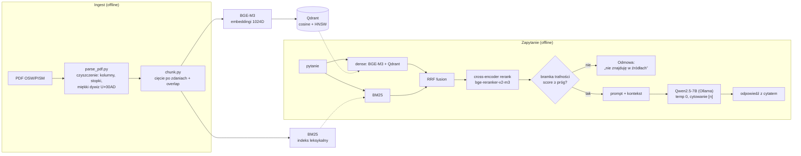

# offline-rag-pl — offline'owy RAG na polskich raportach analitycznych

System **Retrieval-Augmented Generation** działający **w pełni offline**: odpowiada na pytania
na podstawie polskich raportów analitycznych (OSW/PISM), **cytuje źródło** i ma **zmierzoną
jakość** (gold set + metryki + poprawa „przed/po"). Projekt portfolio pod stanowisko AI/LLMOps.

> „RAG na źródłach otwartych, ale architektura jest identyczna dla korpusu niejawnego — całość
> offline, model open-source serwowany lokalnie, dane nie opuszczają systemu. Jakość mam
> zmierzoną: gold set, recall@k, i poprawę po zmianie strategii."

---

## Architektura



Dwustopniowy retrieval (szybki bi-encoder → dokładny cross-encoder), hybryda gęste+leksykalne
(RRF), bramka anty-halucynacyjna i wymuszone cytowanie. Orkiestracja to cienka własna warstwa
(bez ciężkich frameworków).

---

## Wyniki (zmierzone na gold secie: 36 par, w tym 7 spoza korpusu)

### Retrieval — poprawa „przed/po" (29 pytań z korpusu)
| konfiguracja | recall@1 | recall@5 | MRR |
|---|--:|--:|--:|
| dense (baseline) | 0.45 | 0.76 | 0.62 |
| + reranking (cross-encoder) | 0.79 | 0.97 | 0.86 |
| **+ hybryda BM25 (RRF)** | **0.83** | **0.97** | **0.89** |

*Reranking podniósł recall@1 (trafny fragment był w puli, ale nie na górze); hybryda podniosła
sufit recall@10 z 0.93 do 0.97 (BM25 dorzucił trafienia leksykalne, których dense nie wyciągał).*

### Jakość odpowiedzi
| metryka | wynik |
|---|--:|
| refusal — pytania spoza korpusu (gold set, n=7) | 1.00 (0.71 → 0.86 prompt → 1.00 +bramka) |
| refusal — **hard negatives held-out (n=8), pełne 3 guardy** | **7/8** (guard #3 łapie atrybucję, której bramka nie) |
| false-refusal na pytaniach z korpusu — bramka (#2) | **0** |
| false-refusal dodane przez weryfikację (guard #3) | **2/29 (7%)** — świadomy koszt |
| faithfulness (sędzia: Gemma 2, niezależny od generatora) | 0.96 |
| answer relevance | 0.97 |

### Kalibracja progu bramki na HELD-OUCIE — i dlaczego 1.00 było optymistyczne

Próg bramki (`RELEVANCE_GATE_MIN`) był początkowo dobrany na **tym samym gold secie**, na którym
raportowałem `refusal` — to dopasowanie hiperparametru do zbioru testowego. Zbudowałem więc osobny,
**nigdy nieraportowany** zbiór `gold_set/heldout_gate.jsonl` (30 pytań), w którym pytania spoza
korpusu to w większości **hard negatives**: „na temat, ale bez odpowiedzi w naszych 5 raportach".

| top-score rerankera | zakres |
|---|--:|
| pytania z korpusu (n=12) | 0.7376 … 0.9998 |
| spoza korpusu: `daleki` (arytmetyka, wiedza ogólna, n=4) | 0.0000 … 0.0015 |
| spoza korpusu: `sąsiedni-obszar` (n=6) | 0.0014 … 0.1533 |
| spoza korpusu: **`bliski-temat` (hard negatives, n=8)** | 0.0220 … **0.9806** |

**Rozkłady się nakładają** (przerwa −0.243) → nie istnieje próg z zerem przecieków i zerem błędnych
odmów. Front kompromisu: próg 0.1 → przecieki 0.33 / FR 0 · 0.735 → 0.11 / 0 · 0.985 → 0 / **FR 0.33**.
End-to-end na 18 pytaniach OOC: refusal **0.89 z bramką i 0.89 bez bramki** — bramka nie dodaje na
nich nic, bo przecieki mają wysoki score. Oba przecieki to halucynacje **z cytowaniem**:
przypisanie Danii wskaźnika 1,75% PKB (w źródle: **Norwegii**) i zamiana listy ofert w przetargu
HX na jego rozstrzygnięcie.

**Wniosek architektoniczny:** cross-encoder mierzy **trafność tematyczną**, nie **obecność
odpowiedzi** (`relevance ≠ answerability`). To sufit tego sygnału, nie zła wartość progu — błąd
powstaje w warstwie **generacji**, więc kontrolę trzeba postawić właśnie tam.

```bash
python src/eval/calibrate_gate.py --e2e   # rozkłady, przemiatanie progu, odmowa end-to-end
```

### Guard #3 — weryfikacja ugruntowania po generacji (zmierzona)
Skoro błąd powstaje w warstwie generacji, kontrolę postawiłem właśnie tam: po wygenerowaniu
odpowiedzi **inny model-sędzia (Gemma)** sprawdza KAŻDĄ tezę przeciw kontekstowi; za mało popartych
→ odmowa (`src/generate/verify.py`).
- **Wartość:** na 8 hard negatives z held-outu pełne 3 guardy odmawiają **7/8**. Guard #3 sam łapie
  h18 („wydatki obronne Danii jako % PKB" — w źródle to liczba **Norwegii**), którego bramka
  przepuszcza (score 0.98).
- **Koszt (zmierzony, nie założony):** **+7% false-refusal** (2/29) na poprawnych pytaniach z korpusu —
  `VERIFY_MIN_SUPPORTED=1.0` wymaga poparcia WSZYSTKICH tez.
- **Residual:** h19 (lista ofert przetargu podana jako rozstrzygnięcie) wciąż przecieka — 1/8.
- **Trade-off (kontekst wywiadowczy):** fałszywa odmowa = ponowne zapytanie analityka; pewna
  halucynacja = błędna decyzja. Dlatego surowy próg (1.0) jest uzasadniony.

---

## Stack
- **Python 3.11**, orkiestracja = cienka własna warstwa (bez LangChain)
- **Ollama** + **Qwen2.5-7B** (kwantyzacja Q4, GPU) — LLM serwowany lokalnie (domyślny backend)
- **vLLM 0.26** + **Qwen2.5-7B-Instruct-AWQ** — alternatywny backend pod przepustowość
  (×3,4 tok/s przy 4+ równoległych żądaniach; patrz sekcja „Serwowanie LLM")
- **BGE-M3** (sentence-transformers) — embeddingi wielojęzyczne (1024D)
- **Qdrant** (Docker) — baza wektorowa (metryka cosine, indeks HNSW)
- **bge-reranker-v2-m3** — cross-encoder do rerankingu
- **BM25** (własna implementacja Okapi) + **RRF** — hybryda leksykalno-semantyczna
- **Gemma 2 9B** — niezależny model-sędzia do faithfulness (mniejsza cyrkularność)

---

## Uruchomienie
```bash
# 1. Środowisko
conda create -n offline-rag-pl python=3.11 && conda activate offline-rag-pl

# 2. Zależności (torch OSOBNO, z indeksu CUDA pod GPU — tu 12.8 dla Blackwella)
pip install torch --index-url https://download.pytorch.org/whl/cu128
pip install -r requirements.txt

# 3. Baza wektorowa (Qdrant w Dockerze, dane w named volume)
docker run -d --name qdrant-osw -p 6333:6333 -v qdrant_osw_storage:/qdrant/storage qdrant/qdrant

# 4. Modele LLM (raz — wymaga internetu; potem offline)
ollama pull qwen2.5:7b        # generator
ollama pull gemma2:9b         # sędzia do ewaluacji faithfulness

# 5. Pipeline: PDF -> tekst -> chunki -> indeks -> odpowiedź
python src/ingest/parse_pdf.py data/raw/<raport>.pdf data/processed/
python src/ingest/chunk.py
python src/index/build_index.py
python src/generate/answer.py "Które państwa tworzą arktyczny kwartet NATO?"

# 6. Ewaluacja
python src/eval/run_eval.py       # retrieval: recall@k, MRR (dense vs hybryda vs +rerank)
python src/eval/eval_answers.py   # odpowiedzi: refusal, faithfulness, relevance
```
> **Offline w runtime:** po pobraniu modeli ustaw `HF_HUB_OFFLINE=1` — całość działa bez sieci.

---

## UI — lokalny panel analityka

```bash
python src/serve/api.py                    # potem: http://127.0.0.1:8000
SERVE_PORT=8100 python src/serve/api.py    # gdy 8000 jest zajęte
```

Jeden ekran: po lewej odpowiedź z **klikalnymi cytatami** `[n]`, po prawej **panel diagnostyczny**
— etapy pipeline'u z czasami, wynik bramki (`score` vs próg), werdykty sędziego per teza i źródła
z pełnym tekstem chunka. Przełączniki `bramka` / `weryfikacja` / `top_k` pozwalają pokazać
**„przed/po" na żywo**: to samo pytanie z rozbrojonym guardem przecieka halucynacją.

### Zmierzone czasy etapów (RTX 5070 Ti, Qwen2.5-7B Q4 + Gemma 2 9B jako sędzia)

| scenariusz | retrieval | generacja | weryfikacja | **total** | źródła na ekranie |
|---|--:|--:|--:|--:|--:|
| pytanie z korpusu | 923 ms | 3665 ms | 9049 ms | **13,6 s** | **+0,98 s** |
| pytanie odcięte bramką | 648 ms | nie uruchomiono | nie uruchomiono | **0,65 s** | +0,71 s |
| pytanie trudne (dłuższa odpowiedź) | 683 ms | 6268 ms | 13665 ms | **20,6 s** | +0,74 s |

Trzy rzeczy, które te liczby pokazują:
- **Guard #3 kosztuje 2,2-2,5× tyle, co sama generacja** — weryfikacja to osobne wywołanie sędziego
  na każdą tezę. To najdroższa warstwa w systemie i teraz mam to policzone, nie oszacowane.
- **Bramka jest też optymalizacją opóźnienia:** odmowa w 0,65 s zamiast 13,6 s, bo LLM nie jest
  w ogóle pytany.
- **Źródła są na ekranie po ~1 s, odpowiedź po 13-20 s.** Dlatego wysyłamy je w zdarzeniu
  `retrieval`, a nie razem z odpowiedzią — użytkownik czyta fragmenty, gdy model jeszcze pracuje.

### Decyzje projektowe warte odnotowania

- **FastAPI + statyczny HTML/vanilla JS** — dwie zależności, bez npm i build-stepu (Streamlit
  wciąga ~30 paczek tranzytywnych i przeładowuje skrypt przy każdej interakcji, co grozi
  ładowaniem BGE-M3 za każdym kliknięciem).
- **`POST` + NDJSON, nie SSE** — `EventSource` nie obsługuje POST, więc pytanie musiałoby jechać
  w query stringu, a stamtąd do logów dostępowych i historii przeglądarki.
- **Nie strumieniujemy tokenów odpowiedzi, tylko etapy** — guard #3 ocenia odpowiedź *po*
  generacji i może ją odrzucić; streaming pokazałby halucynację przed werdyktem sędziego.
- **Modele ładowane raz, przy starcie** (rozgrzewka ~10 s) — nie przy pierwszym pytaniu.
- **Trzy źródła odmowy rozróżnione w UI** — guard #1 (model sam), #2 (bramka), #3 (weryfikacja)
  znaczą różne rzeczy; zlanie ich w jedno „nie znajduję odpowiedzi" gubi informację, czy szukać dalej.
- **Wyjście LLM-a traktowane jak tekst niezaufany** — wstawiane przez `textContent`/węzły DOM,
  nigdy `innerHTML` (w kontekście bywają znaczniki z PDF-a).

---

## Serwowanie LLM: Ollama vs vLLM (zmierzone)

Brief zakładał „Ollama na start, vLLM docelowo". Backend jest **jedną zmienną**
(`config.LLM_BACKEND`, nadpisywalną środowiskiem), a nie zmianą w pętli RAG — `src/generate/llm.py`
to cienki dyspozytor na `urllib` (bez biblioteki `openai`, bez klienta Ollamy).

```bash
# vLLM żyje w OSOBNYM env conda: przyciąga własny torch (2.11+cu130), a stack retrievalowy
# stoi na cu128 zbudowanym pod Blackwella (sm_120) — wspólna instalacja zdegradowałaby BGE-M3.
conda create -n vllm-server python=3.11 && conda activate vllm-server && pip install vllm==0.26.0
python src/serve/vllm_serve.py                 # parametry z configu; HF_HUB_OFFLINE=1

python src/eval/bench_llm.py --prepare                                # prompty raz, na wolnej karcie
LLM_BACKEND=vllm python src/eval/bench_llm.py --label vllm-awq-util070
python src/eval/bench_llm.py --compare
```

### DOWÓD — przepustowość (Qwen2.5-7B, prompty RAG ~2 400 tokenów, 256 tok. wyjścia, temp 0)

| równoległość | Ollama Q4 [tok/s] | vLLM AWQ [tok/s] | zmiana | p95 Ollama [s] | p95 vLLM [s] |
|---|---|---|---|---|---|
| 1 | 29,7 | 36,9 | ×1,24 | 3,74 | 2,16 |
| 4 | 38,3 | 128,2 | **×3,35** | 9,38 | 1,14 |
| 8 | 37,6 | 127,3 | **×3,39** | 12,39 | 1,29 |

Ollama saturuje się na ~38 tok/s (z 4 na 8 klientów zysk zerowy, p95 rośnie o trzecią część) —
vLLM utrzymuje ~128 tok/s przy p95 **8× niższym**. Mechanizm: dekodowanie jest ograniczone
przepustowością pamięci (na każdy token GPU czyta całe wagi), więc continuous batching czyta wagi
raz dla wielu żądań. Przy równoległości 1 przewaga jest niewielka (×1,24) — i to jest oczekiwane:
vLLM optymalizuje przepustowość serwera, nie czas jednego zapytania.

### Cena: prealokacja VRAM (PagedAttention) — i realne ograniczenie tej maszyny

vLLM zajmuje swój budżet na starcie i trzyma do końca procesu. Rozkład z logu przy `--util 0.7`
na 12 GB (widoczne 11,5 GiB):

```
wagi AWQ 5,29 GiB + szczyt aktywacji 1,04 + non-torch 0,11 + grafy CUDA 0,38 = 6,82 GiB
pula KV-cache: 1,61 GiB = 30 048 tokenów -> MAKS. RÓWNOLEGŁOŚĆ 7,34x przy oknie 4 096
```
1,61 GiB / 30 048 tokenów = **56 KB/token**, dokładnie tyle, ile daje arytmetyka Qwena 2.5-7B
(28 warstw × 4 głowy KV z GQA × 128 × 2 (K,V) × 2 B) — stąd wiadomo, ile sekwencji się zmieści,
zanim cokolwiek uruchomimy.

- Zejście `--util` 0,70 → 0,62 **nic nie zmieniło** (135–139 vs 127–128 tok/s): pula KV była i tak
  większa, niż potrzebują 8 żądania. Poniżej ~0,62 serwer nie wstaje — sam narzut to 6,82 GiB.
- **vLLM i stack retrievalowy nie mieszczą się razem na 12 GB.** Sprawdzone: przy działającym vLLM
  serwer UI dostaje CUDA OOM przy ładowaniu cross-encodera, a zapytanie pada na
  `CUBLAS_STATUS_ALLOC_FAILED`. Ollama tego problemu nie ma, bo ładuje leniwie i **zwalnia** kartę
  po bezczynności (`keep_alive`).
- **Wniosek architektoniczny:** na tym sprzęcie Ollama zostaje pod interaktywne UI (grzecznie dzieli
  GPU z BGE-M3), a vLLM ma sens tam, gdzie liczy się przepustowość i można rozdzielić etapy w
  czasie — czyli w ewaluacji wsadowej (prompty przygotowane wcześniej, potem sam LLM). Na
  dedykowanym GPU produkcyjnym ten kompromis znika.

### DOWÓD — jakość po zmianie kwantyzacji Q4_K_M → AWQ

Zmiana backendu zmienia DWIE rzeczy: silnik i kwantyzację (inne zaokrąglenia wag = inny model
numerycznie). Szybszy silnik z gorszymi odpowiedziami byłby regresją, więc jakość zmierzono na tych
samych promptach (`src/eval/compare_backends.py`, bramka wyłączona — mierzymy sam model):

| metryka | Ollama Q4_K_M | vLLM AWQ |
|---|---|---|
| ugruntowanie tez (sędzia Gemma, n=29) | 0,943 | 0,953 |
| odpowiedzi z cytatem `[n]` | 0,966 | 0,966 |
| false-refusal na pytaniach z korpusu | 0,0 | 0,0 |
| odmowa spoza korpusu (guard #1, sam prompt) | 0,857 | **0,714** |

Wierność i cytowanie bez zmian. Jedyna regresja: AWQ przepuścił **oba** pytania arytmetyczne
(„√144", „15 × 8"), Q4_K_M jedno — ale ich score rerankera to 0,004 i 0,010, więc **bramka (0,35)
zatrzymuje je przed modelem** i odmowa end-to-end zostaje 1,00. Praktyczny argument za obronnością
warstwową: pogorszenie jednego guardu nie przebiło się na wynik pipeline'u.

### Pułapka offline warta zapamiętania

Pierwszy start vLLM padł na `Could not find nvcc` — FlashInfer **kompiluje kernel samplingu JIT-em**
przy starcie i wymaga pełnego CUDA toolkitu, którego koła pip nie zawierają. Rozwiązanie:
`VLLM_USE_FLASHINFER_SAMPLER=0` (generujemy zachłannie, `temperature=0`, więc nic nie tracimy).
Wniosek ogólniejszy dla środowiska air-gapped: kernele kompilowane na maszynie docelowej to
zależność od toolchainu, którego tam zwykle nie ma.

---

## Struktura repo
```
config/config.py        # WSZYSTKIE parametry (chunk size, top_k, modele, progi) w jednym miejscu
src/ingest/             # parse_pdf.py (czyszczenie PDF) + chunk.py (chunking)
src/index/build_index.py# embeddingi -> Qdrant
src/retrieve/           # search.py (dense), bm25.py, hybrid.py (RRF), rerank.py
src/generate/answer.py  # pętla RAG: retrieval -> bramka -> prompt -> LLM -> cytat (+ on_event dla UI)
src/generate/llm.py     # dyspozytor backendów LLM (Ollama /api/generate vs vLLM /v1/chat/completions)
src/generate/verify.py  # guard #3: weryfikacja ugruntowania tez po generacji (sędzia Gemma)
src/serve/              # api.py (3 endpointy), stream.py (mostek callback->iterator), static/ (UI)
src/serve/vllm_serve.py # start serwera vLLM z parametrami z configu (osobne env conda, offline)
src/eval/               # metrics.py, run_eval.py (retrieval), eval_answers.py (odpowiedzi),
                        # calibrate_gate.py (kalibracja progu bramki na held-oucie),
                        # bench_llm.py (przepustowość backendów), compare_backends.py (jakość)
gold_set/gold.jsonl     # zbiór ewaluacyjny (pytanie -> odpowiedź -> chunk źródłowy)
gold_set/heldout_gate.jsonl # held-out do kalibracji progu — NIGDY nieraportowany jako metryka
docs/specs/, docs/plans/# spec i plan implementacji UI (decyzje + odrzucone alternatywy)
tests/                  # chunking, metryki, BM25/RRF, mostek strumienia, kontrakt API, logika app.js
```

---

## Znane ograniczenia (świadome, zmierzone)
- **Kolejność kolumn** w niektórych dwukolumnowych PDF-ach bywa mieszana — wpływ na jakość mały
  po dodaniu hybrydy (zweryfikowane pomiarem).
- **Retrieval pojęciowy** (pytania „dlaczego/jak") słabszy niż faktograficzny (recall@5 ~0.89).
- **Cytowanie per-teza** na modelu 7B bywa nieprecyzyjne (grupuje źródła).
- **Metryki LLM-sędziego** to sygnał, nie prawda absolutna (cyrkularność mimo innego modelu) —
  zalecany ręczny sanity-check; wartości zależą od sędziego (faithfulness 0.88 Qwen vs 0.96 Gemma).
- **Gold set n=29** (z korpusu) — liczby wciąż nieco szumne. Próg bramki jest już kalibrowany na
  **osobnym held-oucie**, nie na gold secie (patrz sekcja o kalibracji).
- **Residual refusal:** przed bramką prosta arytmetyka przeciekała (model liczył); bramka to domyka.
  Na kwantyzacji AWQ przecieka o jedno pytanie więcej niż na Q4_K_M — bramka nadal to domyka.
- **vLLM nie zmieści się obok retrievalu na 12 GB VRAM** (zmierzone: CUDA OOM). Domyślnym backendem
  aplikacji zostaje Ollama; vLLM jest przełączalną opcją pod obciążenia wsadowe i dedykowane GPU.
- **Hard negatives** („na temat, ale odpowiedzi nie ma") — bramka ich nie łapie (`relevance ≠
  answerability`); dołożony guard #3 (weryfikacja ugruntowania po generacji) łapie **7/8** na
  held-oucie, ale kosztem **~7% false-refusal** na poprawnych odpowiedziach i z 1 przeciekiem
  (h19, oferta jako fakt). System nie jest tu idealny — każdą warstwę mierzę osobno.
