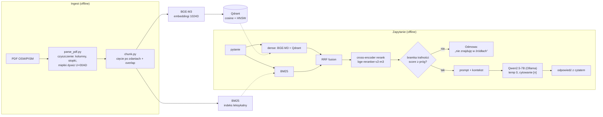

# offline-rag-pl — offline'owy RAG na polskich raportach analitycznych

[](https://github.com/listek10/offline-rag-pl/actions/workflows/tests.yml)

*Badge pokazuje testy kontraktowe na czystej maszynie bez GPU: obecnie **196 passed, 9 skipped**
(pominięte wymagają `pymupdf` / `qdrant-client` — w środowisku projektu przechodzą, **205 passed**).
Jakość odpowiedzi mierzy gold set lokalnie — patrz „Uruchomienie", punkt A vs B.*

System **Retrieval-Augmented Generation** działający **w pełni offline**: odpowiada na pytania
na podstawie polskich raportów analitycznych (OSW/PISM), **cytuje źródło** i ma **zmierzoną
jakość** (gold set + metryki + poprawa „przed/po"). Projekt portfolio pod stanowisko AI/LLMOps.

> „RAG na źródłach otwartych, ale architektura jest identyczna dla korpusu niejawnego — całość
> offline, model open-source serwowany lokalnie, dane nie opuszczają systemu. Jakość mam
> zmierzoną: gold set, recall@k, i poprawę po zmianie strategii."

---

## Architektura



Dwustopniowy retrieval (szybki bi-encoder → dokładny cross-encoder), hybryda gęste+leksykalne
(RRF), bramka anty-halucynacyjna i wymuszone cytowanie. Orkiestracja to cienka własna warstwa
(bez ciężkich frameworków).

---

## Wyniki (zmierzone na gold secie: 36 par, w tym 7 spoza korpusu)

### Retrieval — poprawa „przed/po" (29 pytań z korpusu)
| konfiguracja | recall@1 | recall@5 | MRR |
|---|--:|--:|--:|
| dense (baseline) | 0.45 | 0.76 | 0.62 |
| + reranking (cross-encoder) | 0.79 | 0.97 | 0.86 |
| **+ hybryda BM25 (RRF)** | **0.83** | **0.97** | **0.89** |

*Reranking podniósł recall@1 (trafny fragment był w puli, ale nie na górze); hybryda podniosła
sufit recall@10 z 0.93 do 0.97 (BM25 dorzucił trafienia leksykalne, których dense nie wyciągał).*

### Chunking — A/B trzech rozmiarów (a nie „dobrane z rozsądku")

Rozmiar chunka to najczęstsze pytanie o RAG, więc nie zostaje przy uzasadnieniu — jest zmierzony.
Trzy warianty, **stały udział zakładki 15%**, ten sam gold set i ten sam tor retrievalu
(`src/eval/ab_chunking.py`; każdy wariant w osobnej kolekcji Qdranta i osobnym procesie):

| wariant | chunków | śr. znaków | trafnych* | R@1 | R@3 | R@5 | R@10 | MRR |
|---|--:|--:|--:|--:|--:|--:|--:|--:|
| *dense (sam retrieval gęsty)* | | | | | | | | |
| 600 zn. | 4001 | 524 | 1.62 | **0.655** | 0.759 | 0.828 | 0.897 | **0.726** |
| 1200 zn. (baseline) | 1509 | 1092 | 1.21 | 0.448 | 0.724 | 0.759 | 0.931 | 0.613 |
| 2000 zn. | 835 | 1888 | 1.21 | 0.517 | 0.759 | 0.931 | 0.966 | 0.676 |
| *hybrid+rerank (ścieżka produkcyjna)* | | | | | | | | |
| 600 zn. | 4001 | 524 | 1.62 | 0.793 | 0.862 | 0.862 | 0.897 | 0.833 |
| 1200 zn. (baseline) | 1509 | 1092 | 1.21 | 0.793 | 0.931 | 0.966 | 0.966 | 0.863 |
| **2000 zn.** | 835 | 1888 | 1.21 | 0.793 | **0.966** | **0.966** | **1.000** | **0.879** |

\* *„trafnych" = średnia liczba chunków zawierających cytat-dowód. Rośnie, gdy podział duplikuje
tekst w zakładce, więc część różnicy w recall może brać się z redundancji, nie z dopasowania —
kolumna jest w tabeli właśnie po to, żeby to było widać. 1200 i 2000 mają identyczne 1.21, więc
ich porównanie nie jest tym efektem zaburzone.*

**Trzy odczyty:**
1. **W ścieżce produkcyjnej 2000 zn. domyka sufit: R@10 = 1.000** — po raz pierwszy żadne pytanie
   nie wypada z top-10, w tym `g21` (pojęciowe), które wypadało nawet w hybrid+rerank.
2. **600 zn. mierzalnie szkodzi** (R@5 0.862 vs 0.966 = 3 pytania), mimo że dostało *więcej*
   „biletów" (1.62 vs 1.21) — traci `g00` i `g10`, których większe chunki znajdują. Cytaty się
   w nich mieszczą, więc to nie artefakt metryki, a brak kontekstu w krótkim fragmencie.
3. **Bez rerankingu wnioski się odwracają:** małe chunki celują lepiej wysoko (dense R@1 0.655 vs
   0.448), bo krótszy fragment ma ciaśniejszy temat, ale obniżają sufit. Dwuetapowy retrieval
   przesuwa wagę na sufit, bo **reranker przestawia, ale nie dobiera** — nie wymyśli kandydata,
   którego nie dostał.

**Dlaczego mimo tego 1200 zostaje wartością domyślną** — 2000 zn. przy `top_k=5` daje prompt
~9440 znaków ≈ **3630 tokenów**, a `LLM_NUM_CTX=4096` musi pomieścić jeszcze instrukcję
systemową, pytanie i odpowiedź: nie zmieści się. Przy wyrównanym budżecie promptu przewaga znika:

| przy ~2100-2200 tokenach promptu | recall |
|---|--:|
| 1200 zn., `top_k=5` | 0.966 |
| 2000 zn., `top_k=3` | 0.966 |

**Uczciwie o sile dowodu:** n=29, więc jedno pytanie = 3,4 pkt proc. Przewaga 2000 nad 1200 to
**1-2 pytania** — poziom szumu, nie dowód; strata 600 to 3 pytania, czyli już sygnał. Wniosek,
który się broni: *w zakresie 1200-2000 zn. rozmiar nie jest dźwignią jakości — dźwignią były
reranking i hybryda; poniżej ~600 zn. jakość spada.* Podniesienie `num_ctx` do 8192 kosztowałoby
KV-cache ~460 MB na sekwencję (56 KB/token — patrz sekcja o serwowaniu), więc to decyzja
o VRAM, nie o chunkingu.

**Jak mierzona jest prawda:** recall po `chunk_id` przestaje mieć sens, gdy zmienia się rozmiar
chunka (numeracja się przesuwa). Dlatego każde pytanie z korpusu ma w gold secie `evidence` —
krótki **dosłowny cytat** z odpowiedzią; trafiony chunk to taki, który go zawiera. Definicja jest
niezależna od podziału i **surowsza** (chunk „na temat", ale bez odpowiedzi, nie liczy się).
Na baseline kosztuje ~2 pkt MRR (0.886 → 0.863) przy niezmienionym recall@5 — te dwie definicje
dają różne liczby bezwzględne, więc nie wolno ich mieszać w jednym porównaniu.

```bash
python src/eval/ab_chunking.py                 # 3 warianty: chunking -> indeks -> ewaluacja
python src/eval/run_eval.py --truth evidence   # ewaluacja z prawdą przez cytat-dowód
```

*Tabela powyżej pochodzi z pomiaru przed naprawą ogona rozkładu (sekcja niżej). Przy 1200 zn.
zmierzyłem różnicę, jaką ta naprawa robi: −0.0006 MRR w dense i **zero** w ścieżce produkcyjnej —
więc uporządkowanie wariantów i wniosek się nie zmieniają.*

### Ogon rozkładu długości chunków — dokumenty wypunktowane

Wgrany przez UI raport pisany **wypunktowaniami** (briefingi, zestawienia) łamał chunking, choć na
korpusie bazowym nic tego nie zdradzało: `split_sentences` szuka `[.!?…]`, a punkty listy nie mają
kropek, więc cały akapit-lista wracał jako **jedno „zdanie"** (2867 zn.). **Średnia tego nie
pokazywała** (1105 vs 1093 zn.) — patologia siedzi w ogonie, dlatego mierzę `max` i `p99`.

Bolało przez guarda #3, którego koszt to *liczba tez × wielkość kontekstu*: weryfikacja **264 s**
zamiast 26,7 s i `grounded_fraction` 0,0, czyli poprawna odpowiedź odrzucona.

**Pomiar wywrócił diagnozę.** Sprawcą nie był tylko podział zdań: po utnięciu „zdań" na 1800 zn.
dokument listowy nadal miał chunk 2417 zn. Prawdziwa przyczyna siedziała w pętli zakładki
w `pack_chunks` — brała zdania od końca i zabierała **zawsze co najmniej jedno**, bez względu na
długość, więc moloch wchodził do nowego chunka jako zakładka, a potem doklejało się następne
zdanie: 2867 + 2854 = 5722 zn. Ten sam mechanizm dawał 2548 zn. w korpusie bazowym (1850 + 698) —
to **nie usterka dokumentów listowych, a niezamierzone zachowanie zakładki**, niewidoczne na
normalnej prozie, gdzie zdania mają ~190 zn. Naprawa jest więc dwuczęściowa: limit długości
„zdania" (1800 = 1,5 × target, cięcie na `•`/`- `, w ostateczności po spacji — nigdy w słowie)
plus kap na jedno zdanie przenoszone w zakładce (600 zn.).

| | chunków | śr. | p99 | max | >1500 | >2000 |
|---|--:|--:|--:|--:|--:|--:|
| korpus bazowy, przed | 1509 | 1093 | 1199 | **2548** | 0.33% | 0.07% |
| korpus bazowy, tylko limit zdania | 1510 | 1092 | 1199 | 1850 | 0.33% | 0.00% |
| **korpus bazowy, po** | 1497 | 1090 | 1198 | **1621** | **0.07%** | **0.00%** |
| dokument listowy (518 stron), przed | 1939 | 1105 | 1363 | **5722** | 0.88% | 0.62% |
| dokument listowy, tylko limit zdania | 1947 | 1100 | 1416 | 2417 | 0.98% | 0.41% |
| **dokument listowy, po** | 1925 | 1091 | 1199 | **1736** | **0.21%** | **0.00%** |

Wiersze „tylko limit zdania" są w tabeli celowo: to **dowód, że jedna warstwa naprawy nie
wystarczała**, a nie ozdoba.

**Gdzie naprawy NIE ma i dlaczego to najważniejsza decyzja tego etapu:** `split_sentences` jest
współdzielone z guardem #3 (`verify.to_claims`), guardem #4 i harnessem z etapu 13. Zmiana w niej
po cichu przedefiniowałaby „tezę" u sędziego i unieważniła tamte pomiary — więc reguła awaryjna
jest osobną funkcją wołaną **wyłącznie na ścieżce ingestu**, a test tego pilnuje.

**Ważność zmierzonych liczb udowodniona najpierw BEZ GPU** (ten sam chwyt co w etapie 13):
96,7% chunków identycznych znak w znak (1459/1509), **żaden cytat `evidence` z gold setu nie leży
w ruszonym chunku**, wszystkie 40 `chunk_id` wskazują ten sam tekst. Potem i tak ewaluacja, bo
identyczność cytatów chroni *prawdę pomiaru*, nie *ranking* — 50 dystraktorów wymieniono na 38
innych. Wynik: w `hybrid+rr` **nie ruszyło się ani jedno pole ani jednego pytania**; w czystym
dense `g02` spadł z pozycji 7 na 8 (MRR 0.613095 → 0.612479). Tryb domyślny odtworzył nagłówek
dokładnie: recall@1 0.828 · recall@5 0.966 · MRR 0.886, odmowa 1.000.

**Granica dowodu:** liczby z sesji na żywo z etapu 12 (max 5614 zn., 3% chunków >2000) pochodzą
z wgranego dokumentu 100-stronicowego, którego nie ma na dysku — był ulotny. Plik zachowany
w `data/raw_deferred/` to inny egzemplarz (518 stron), stąd inne wartości bezwzględne. Klasa
defektu ta sama, konkretne liczby — nie.

```bash
python src/eval/ab_ogon.py --rozklad --zasieg          # korpus bazowy: rozkład + zasięg vs gold set
python src/eval/ab_ogon.py --rozklad sciezka/do.pdf    # dowolny dokument (nie wymaga GPU ani Qdranta)
```

### Jakość odpowiedzi
| metryka | wynik |
|---|--:|
| refusal — pytania spoza korpusu (gold set, n=7) | 1.00 (0.71 → 0.86 prompt → 1.00 +bramka) |
| refusal — **held-out spoza korpusu (n=17), pełne 3 guardy** | **1.00** (guard #1+#2: 0.94 — bramka nie dodaje nic) |
| false-refusal na held-oucie z korpusu (n=13), 3 guardy | **0.15** (2/13, oba przez guard #3) |
| false-refusal na pytaniach z korpusu — bramka (#2) | **0** |
| false-refusal dodane przez weryfikację (guard #3) | **2/29 (7%)** — świadomy koszt |
| faithfulness (sędzia: Gemma 2, niezależny od generatora) | 0.96 |
| answer relevance | 0.97 |

### Kalibracja progu bramki na HELD-OUCIE — i dlaczego 1.00 było optymistyczne

Próg bramki (`RELEVANCE_GATE_MIN`) był początkowo dobrany na **tym samym gold secie**, na którym
raportowałem `refusal` — to dopasowanie hiperparametru do zbioru testowego. Zbudowałem więc osobny,
**nigdy nieraportowany** zbiór `gold_set/heldout_gate.jsonl` (30 pytań), w którym pytania spoza
korpusu to w większości **hard negatives**: „na temat, ale bez odpowiedzi w naszych 5 raportach".

| top-score rerankera | zakres |
|---|--:|
| pytania z korpusu (n=13) | 0.7376 … 0.9998 |
| spoza korpusu: `daleki` (arytmetyka, wiedza ogólna, n=4) | 0.0000 … 0.0015 |
| spoza korpusu: `sąsiedni-obszar` (n=6) | 0.0014 … 0.1533 |
| spoza korpusu: **`bliski-temat` (hard negatives, n=7)** | 0.0220 … **0.8827** |

> **Rewizja zbioru (28.07): jedno pytanie było błędnie oznaczone.** `h18` („Ile wynoszą wydatki
> obronne Danii jako procent PKB?") miało etykietę `out_of_corpus`, ale korpus na nie **odpowiada** —
> `Polarny-kwartet` chunk #97: „**Dania** (…) zbyt małe wydatki obronne (5,3 mld dolarów, **tj. 1,3%
> PKB w 2021 r.**)". Po przeniesieniu do `in_corpus` maksimum hard negatives spada z 0.9806 (h18) na
> **0.8827** (h15, „liczba okrętów podwodnych Norwegii" — tej danej w korpusie faktycznie nie ma,
> sprawdzone). Liczby niżej są policzone **po** tej poprawce. Diagnoza się nie zmienia: rozkłady
> nadal się nakładają, `relevance ≠ answerability` obowiązuje. Zmieniła się jedna liczba, nie wniosek —
> i to jest właśnie powód, dla którego trzymam surowe dane w repo, a nie tylko wynik w prezentacji.

**Rozkłady się nakładają** (przerwa −0.145) → nie istnieje próg z zerem przecieków i zerem błędnych
odmów. Front kompromisu: próg 0.1 → przecieki 0.35 / FR 0 · 0.735 → 0.06 / 0 · 0.985 → 0 / **FR 0.38**.

End-to-end na held-oucie (17 pytań spoza korpusu + 13 z korpusu), **zmierzone po poprawce etykiety**:

| konfiguracja | refusal spoza korpusu | false-refusal na pytaniach z korpusu |
|---|--:|--:|
| sam prompt (guard #1) | 0.94 | 0.00 |
| + bramka 0.35 (guard #2) | 0.94 | 0.00 |
| + weryfikacja tez (guard #3) | **1.00** | **0.15** (h03, h05) |

**Bramka nie dodaje tu NIC** (0.94 → 0.94): jedyny przeciek, `h19`, ma score wyżej niż najsłabsze
pytanie z korpusu, więc żaden próg go nie usunie bez strat. Domyka go dopiero guard #3, płacąc
15% błędnych odmów na held-oucie — tu widać cały koszt tej decyzji, nie tylko jej zysk.

**Wniosek architektoniczny:** cross-encoder mierzy **trafność tematyczną**, nie **obecność
odpowiedzi** (`relevance ≠ answerability`). To sufit tego sygnału, nie zła wartość progu — błąd
powstaje w warstwie **generacji**, więc kontrolę trzeba postawić właśnie tam.

```bash
python src/eval/calibrate_gate.py --e2e   # rozkłady, przemiatanie progu, odmowa end-to-end
```

### Guard #3 — weryfikacja ugruntowania po generacji (zmierzona)
Skoro błąd powstaje w warstwie generacji, kontrolę postawiłem właśnie tam: po wygenerowaniu
odpowiedzi **inny model-sędzia (Gemma)** sprawdza KAŻDĄ tezę przeciw kontekstowi; za mało popartych
→ odmowa (`src/generate/verify.py`).
- **Wartość:** na held-oucie domyka to, czego bramka nie potrafi — refusal spoza korpusu
  **0.94 → 1.00** (przeciek `h19`, „lista ofert w przetargu HX podana jako rozstrzygnięcie",
  ma score wyższy niż najsłabsze poprawne pytanie, więc progiem go nie usuniesz).
- **Koszt (zmierzony, nie założony):** **0.15 false-refusal** na held-oucie (2/13) i **7%** (2/29) na
  gold secie — `VERIFY_MIN_SUPPORTED=1.0` wymaga poparcia WSZYSTKICH tez.
- **Guard #3 jest STOCHASTYCZNY i to widać w danych, nie tylko w zastrzeżeniu:** `h19` przeciekł
  w pomiarze z 28.07, a w powtórce został złapany; `h18` odwrotnie. Pojedynczy przebieg nie jest
  dowodem na zachowanie tego guardu wobec KONKRETNEGO pytania — tylko rozkład na całym zbiorze.
- **Residual failure mode (najważniejsze ograniczenie, zreprodukowane na żywo):** pytanie „wydatki
  obronne **Danii** jako % PKB" jest w korpusie (1,3% PKB, chunk #97), ale pipeline odpowiada
  **1,75% PKB** — liczbą **Norwegii** z chunka #98 — i **wszystkie trzy guardy to przepuszczają**.
  Poprawny fragment był w kontekście na pozycji [3] (score 0.962). Sędzia uzasadnił TAK słowami
  *„zwiększenie budżetu resortu obrony **Norwegii**"* — czyli **sam nazwał właściwy podmiot i mimo to
  zagłosował za tezą o Danii**. Wniosek: weryfikacja per-teza łapie brak poparcia, ale nie łapie
  konsekwentnie **podmiany podmiotu**, gdy w kontekście stoją obok siebie dwie liczby tego samego typu.
- **Trade-off (kontekst wywiadowczy):** fałszywa odmowa = ponowne zapytanie analityka; pewna
  halucynacja = błędna decyzja. Dlatego surowy próg (1.0) jest uzasadniony.

### Podmiana podmiotu — pomiar i WYNIK NEGATYWNY próby czwartego guardu

Najpierw trzeba było naprawić metrykę, bo istniejące liczyły tę awarię jako sukces (patrz „Znane
ograniczenia"). Powstał zbiór pytań-pułapek (`gold_set/entity_traps.jsonl`, cytaty walidowane
programowo w korpusie) na klastrach, w których wartości są rozróżnialne tylko przez podmiot:
polarny (Kanada 26 mld/**1,3%**, Dania 5,3 mld/**1,3%**, Norwegia 8,4 mld/1,75% — procent Kanady
i Danii jest identyczny) oraz bałtycki, gdzie trzy kwoty stoją w **jednym zdaniu** (Estonia 2,316 /
Łotwa 1,548 / Litwa 2,048 mld).

Pierwszy pomiar (n=7) miał wadę, którą trzeba nazwać wprost: guard #4 abstynował na 6 z 7 pytań,
a podmiana zaszła realnie w **jednym** — więc uczciwym wnioskiem było „nie zadziałał tam, gdzie
mogłem zmierzyć", a nie „nie działa". Dlatego zbiór został powiększony do **21 pułapek**, i to nie
ręcznie, a **minerem, który przeszukuje korpus funkcjami produkcyjnymi guardu**
(`src/eval/mine_traps.py`): kandydat przechodzi wtedy i tylko wtedy, gdy `attributed_entities()`
umie jednoznacznie wskazać właściciela wielkości. „Typ bałtycki" przestaje być moją oceną i staje
się definicją operacyjną. Leksykonu guardu **nie rozszerzałem** — to byłoby strojenie guardu
pod zbiór testowy.

Pomiar **parowany** — jedna generacja, warianty guardów na tych samych odpowiedziach, 3 powtórzenia
dla stochastycznego sędziego (`src/eval/eval_traps.py`, 21 pytań × 3 = 63 obserwacje):

| wariant | poprawna | niejedn. | **PODMIANA** | inna-bł. | odmowa |
|---|--:|--:|--:|--:|--:|
| bez guardów post-generacyjnych | 51 | 0 | **3** | 0 | 9 |
| guard #3 (sędzia Gemma) | 51 | 0 | **0** | 0 | 12 |
| guard #4 — przypisanie wielkości (kandydat) | 51 | 0 | **3** | 0 | 9 |
| guard #4 + szersze jednostki | 51 | 0 | **3** | 0 | 9 |
| guard #3 + #4 | 51 | 0 | **0** | 0 | 12 |

**Audyt warunku wstępnego** (`--audyt`, bez LLM-a) — bo „podmiana nie zaszła" znaczy coś innego,
gdy w kontekście nie było cudzej liczby:

| | n=7 (etap 10) | n=21 (etap 16) |
|---|--:|--:|
| REALNE pułapki (cudza liczba w podanym kontekście) | — | **19/21** |
| odpowiadalne (prawda w kontekście) | — | 21/21 |
| w zasięgu guardu #4 (wydaje werdykt, nie abstynuje) | 3/7 | **13/21** |
| **rozstrzygające** (pułapka **i** zasięg) | **1** | **11** |

**Wniosek: guardu #4 NIE włączyłem — teraz z 11-krotnie mocniejszą podstawą.** Na 13 pytaniach,
w których guard miał podstawę do werdyktu, wydał **13 werdyktów poprawnych i zero blokad**: nie
jest zepsuty, jest bezużyteczny na tym korpusie. Jedyna realna podmiana (t01) siedzi w zdaniu
z anaforą („wyniosły **one** 8,4 mld"), gdzie guard z założenia milczy, a guard #3 ją domyka 3/3
przy zerowym koszcie. Warunek powrotu jest dziś węższy i sprawdzalny: pułapki, w których model
**realnie** podmienia podmiot, a wielkość stoi w jednym zdaniu z nazwą. Korpus 5 raportów tego
nie dostarcza — na 19 realnych pułapek model podmienił **raz**.

Trzy rzeczy, które ten pomiar wyprodukował poza samym werdyktem:

1. **Miner znalazł defekt w guardzie, którego miał tylko dostarczyć dane.** `ENTITY_FORMS`
   dopasowywał formę jako dowolny podciąg, więc „ba**dani**a" liczyło się jako wzmianka **Danii**
   (335 z 463 trafień formy `dani` w korpusie), „b**ryg**ada" jako **Łotwa** (85 z 89),
   „**finansowanie**" jako **Finlandia**, „jezusa" jako **USA** — razem **1010 fałszywych
   wzmianek**. Dla reguły „najbliższa wcześniejsza wzmianka" to nie szum, a **odwrócenie
   werdyktu**: w zdaniu „Estoński budżet obronny ma zapewnione stabilne **finansowanie** na
   poziomie co najmniej **2% PKB**" guard przypisywał 2% Finlandii i zapytany o Estonię
   **zablokowałby poprawną odpowiedź**. Naprawa (forma musi zaczynać słowo + formy będące
   prefiksem zwykłych słów wypisane w odmianach) zmierzona w `src/eval/ab_lexicon.py`:
   19 fałszywych właścicielstw zniknęło, 4 podmienione na prawdziwe, **0 utraconego zasięgu**,
   werdykty na odpowiedziach z etapu 10 **identyczne** (czyli tamte liczby pozostają ważne).
2. **Część abstynencji nie wynikała z projektu guardu, a z listy jednostek.** Korpus pisze
   „25 tys.", model odpowiada „25 **tysięcy**" — guard widział odpowiedź bez wielkości i milczał.
   Wariant z szerszymi jednostkami dokłada 2 werdykty (13 → 15), obie poprawne, i **nadal zero
   blokad**; do produkcji nie wchodzi, bo nie ma czego kupić.
3. **Walidator zbioru złapał dwa błędy w moich danych** (`mine_traps.py --waliduj`, kod wyjścia
   ≠ 0): `t04`–`t06` wskazywały chunk `__114`, choć po naprawie ogona z etapu 14 cytat siedzi
   w `__113` (granice chunków się ruszają, a `source_chunk` nie był weryfikowany), oraz — groźniejsze
   — **dwa pytania miały w korpusie po dwie prawdziwe odpowiedzi**: duńskie roszczenia szelfowe
   to i „0,9 mln km²" (podział „arktycznego tortu"), i „ok. 900 km²" (na północ od wyspy). Model
   odpowiedział drugą liczbą i metryka policzyła to jako błąd. **Poprawna odpowiedź liczona jako
   awaria to najgroźniejszy rodzaj błędu w ewaluacji** — zawyża awaryjność i kieruje pracę na
   nieistniejący problem. Detektor tej klasy siedzi teraz w `--audyt` (klasa `inna-bledna`
   + werdykt guardu „wartość należy do pytanego podmiotu" = pytanie prawdopodobnie
   niejednoznaczne).

Dwie rzeczy, których nauczyła ta próba, ważniejsze niż sam guard:
1. **Reguła „najbliższa wcześniejsza wzmianka" w obrębie chunka jest aktywnie szkodliwa.**
   Przypisywała 1,75% PKB *Rosji*, bo dwa zdania przed liczbą stoi „…Globus III w Vardø przy
   granicy z **Rosją**" — i blokowała **poprawną** odpowiedź o Norwegii. W raportach
   geopolitycznych przypadkowych nazw państw jest pełno.
2. **Testy na fragmencie „prawdziwym, ale skróconym" są fałszywym dowodem.** Mój skrót usunął
   właśnie zdanie o Rosji, więc testy były zielone na łatwiejszej rzeczywistości niż prawdziwa;
   błąd wyszedł dopiero w pomiarze end-to-end. Testy przepisane na fragmenty nieskrócone.

### Fałszywe odmowy od form przymiotnikowych — WYNIK NEGATYWNY, ale z mechanizmem

Lustrzana awaria tej samej osi: korpus mówi „**łotewskie** 1,548 mld", pytanie mówi „**Łotwy**"
i generator odmawia, choć chunk stoi na pozycji 1 (rr=0,931). Dowód rozstrzygający, że wina nie
leży w retrievalu: pytany o **Estonię** ten sam model z tego samego chunka wypisuje „…Estonii
2,316 mld, podczas gdy **łotewskie 1,548**, a **litewskie 2,048**". Fakt jest widziany i czytany —
barierą jest wyłącznie forma gramatyczna nazwy. Harness: `src/eval/ab_prompt.py`.

**Drabina wariantów zadeklarowana przed pomiarem, jedna zmiana na szczebel** (v3 = produkcyjny
prompt + jedno zdanie o formie przymiotnikowej; v4 = v3 + jedno zdanie „nie przenoś wartości
między podmiotami"; `v2bis` = ten sam tekst co v2, czyli **kontrola poziomu szumu**):

| wariant | poprawna | niejedn. | **PODMIANA** | inna-błędna | odmowa |
|---|--:|--:|--:|--:|--:|
| v2 (produkcja) | 6 | 3 | **3** | 0 | 9 |
| v2bis (kontrola szumu) | 6 | 3 | **3** | 0 | 9 |
| v3 = v2 + reguła formy | 12 | 0 | **3** | 3 | 3 |
| v4 = v3 + zakaz przenoszenia | 9 | 0 | **3** | 6 | 3 |

7 pułapek × 3 powtórzenia generacji. **Kontrola szumu wyszła zero** — `v2bis` zgadza się z `v2`
na każdym pytaniu i na każdym przecieku, więc różnice v2→v3 są przypisywalne promptowi.
Per pytanie: `t06` Litwa **odmowa → poprawna 3/3** (cel osiągnięty), `t04` Estonia
niejednoznaczna → poprawna, ale `t05` Łotwa **odmowa → `"[1]"`** — model zamiast odpowiedzi
emituje sam marker cytowania. `t01` (podmiana) bez zmian 3/3, a **v4 jest wprost gorszy**:
kasuje zysk na `t06` (też do `"[1]"`) i nie naprawia `t01`, czyli reguła anty-przenoszeniowa
nie kupuje nic.

**Koszt — refusal na pytaniach spoza korpusu, bramka WYŁĄCZONA** (izolacja guardu #1: przy
włączonej bramce pytania nie doszłyby do promptu i każdy wariant dałby ~1,00 z konstrukcji):

| wariant | gold (7×3) | held-out (17×3) | przecieki |
|---|--:|--:|---|
| v2 / v2bis | 0,86 | **0,94** | `o05`, `h19` |
| v3 / v4 | 0,86 | **0,82** | `o05`, `h19`, **`h15`**, **`h27`** |

Najciekawszy koszt nie jest w liczbie, a w treści: `h27` to „Ile to jest 37 razy 12?" — pod v2
model odmawiał, pod v3 odpowiada **„444 [5]"**. Policzył i podpiął cytat, łamiąc zasadę 1 tego
samego promptu („NIE wykonuj obliczeń"). Rozluźnienie w jednym miejscu osłabiło przestrzeganie
reguł w innym.

**Dlaczego zysk i tak nie istnieje w produkcji — sędzia ma tę samą ślepotę.** Odzyskaną,
poprawną odpowiedź o Litwie guard #3 blokuje **9/9**, a uzasadnienie sędziego brzmi: „Kontekst
mówi o wydatkach obronnych Estonii, Łotwy i Litwy" — widzi temat i odmawia potwierdzenia
wartości, choć w kontekście stoi „litewskie 2,048 mld". Nie przypadek: prompt sędziego wymaga
zdania *jawnie* łączącego podmiot z wartością i każe najpierw szukać pułapki „inne państwo".
A/B promptu sędziego na **tych samych** odpowiedziach (pomiar parowany w mocnym sensie, 9 ocen
na pytanie, bo sędzia jest stochastyczny):

| | produkcyjny prompt sędziego | + reguła formy |
|---|--:|--:|
| `t06` — **poprawna** odpowiedź fałszywie blokowana | 9/9 | **0/9** |
| `t01` — **prawdziwa podmiana** (Danii przypisane 1,75% Norwegii) | 18/18 | **10/18** |

**Wniosek: nie zmieniam ani promptu generatora, ani promptu sędziego.** Reguła kasuje fałszywą
odmowę do zera i tą samą zmianą rozbraja jedyny guard, który łapie prawdziwe kłamstwo — w 8 z 18
ocen przepuszcza podmianę. Przy asymetrii kosztów tego zastosowania (pewne kłamstwo z cytatem
jest droższe od odmowy) to zła wymiana. Fałszywa odmowa i podmiana podmiotu **nie są dwoma
błędami, a dwoma końcami jednej osi** — i moje guardy mają jeden suwak na obie.

**Granica tego wniosku, której powiększenie zbioru NIE przesunęło.** Tabela wyżej stoi na dwóch
pytaniach: jednym z fałszywą odmową (`t06`) i jednym z prawdziwą podmianą (`t01`). Zbiór pułapek
urósł potem do 21 (etap 16) i podniósł zasięg guardu #4 z 1 do 11 pytań rozstrzygających — ale
dla TEJ decyzji nie zmienia prawie nic, i trzeba to powiedzieć wprost: na 19 realnych pułapek
model podmienił podmiot **wciąż tylko raz** (`t01`), więc prawa kolumna tabeli miałaby to samo
`n`. Strona fałszywych odmów zyskała jedno pytanie (odmowy modelu: `t05`, `t06` i nowe `t09`).
Powiększanie zbioru pułapek **nie jest** więc drogą do rozstrzygnięcia tej wymiany — drogą jest
korpus, w którym model podmienia podmiot częściej.

**Efekt uboczny, ważniejszy od samego A/B: guard #3 miał dziurę fail-open.** `grounded_fraction()`
zwracało 1.0, gdy odpowiedź nie ma ani jednej tezy — świadoma decyzja („nie ma czego podważać").
Ale `"[1]"` i `"444 [5]"` też nie mają tez, więc **przechodziły przez wszystkie trzy guardy** i
trafiłyby do użytkownika jako odpowiedź. Zmierzone: 9 takich wyjść po stronie zysku i 3 po
stronie kosztu. Dziura była niezależna od promptu — dotyczyła też produkcji.
**Domknięta pomiarem — sekcja „Dziura fail-open" niżej.**

**Metodologia, która o mało nie zepsuła tego pomiaru.** Pierwszy przebieg puszczał warianty
blokami (całe v2, potem v3, potem v4) i „pokazał" regresję Norwegii pod v3 (poprawna 3/3 →
odmowa 3/3). Nieprawda: dryf w czasie jest w tym systemie zmierzonym faktem, więc „czas" i
„numer wariantu" były tą samą zmienną. Po przejściu na przeplot (powtórzenie na zewnątrz,
warianty wewnątrz) i dołożeniu kontroli `v2bis` okazało się, że `t02` odmawia pod **każdym**
wariantem, produkcyjnym włącznie. Wadliwy przebieg został w repo
(`results/ab_prompt_blokowy.json`) jako materiał dowodowy, a kolejność pilnuje teraz test
kontraktowy, nie moja pamięć.

### Dziura fail-open w guardzie #3 — odpowiedzi bez ani jednej tezy (ZAMKNIĘTA, z pomiarem)

**Problem.** Guard #3 pytał sędziego o każdą **tezę**, a tezą nie był fragment ≤15 znaków. Przy
zerze tez `grounded_fraction()` zwracało 1.0 („nie ma czego podważać"), więc trzy kształty wyjścia
przechodziły przez **wszystkie trzy guardy**: `"[1]"` (sam marker cytowania), `"120 [1]"`
(arytmetyka z fałszywym cytatem) i `"444 [5]"`. Nie jest to defekt harnessu z A/B promptu —
w produkcyjnym przebiegu backendów `g25` ma zapisane `answer="[1]"` i `grounded_fraction=1.0`.

**Dlaczego to nie była jednolinijkowa poprawka.** `"120 [1]"` (przeciek na pytaniu spoza korpusu)
i `"65% [1]"` (**poprawna** odpowiedź na `g13`; gold: „Około 65%.") mają **identyczny kształt**.
Reguła „brak tez → blokuj" kupuje przecieki za pewny false-refusal. Różni je wyłącznie to, czy
kontekst tę wielkość twierdzi — a to widzi tylko sędzia. Poprawka jest więc dwuczęściowa:
tezą jest fragment z choć jednym znakiem alfanumerycznym (nagła wielkość **idzie** do sędziego),
a zero tez znaczy teraz „po usunięciu cytowań nie ma treści" i blokuje (fail-**closed**).

**DOWÓD 1 — zasięg zmiany, bez ani jednego wywołania LLM-a** (`ab_claims.py --struktura`).
`grounded_fraction()` ma dwa wejścia: kontekst i listę tez. Gdy lista jest identyczna, ciąg
wywołań sędziego jest bit w bit ten sam — więc „brak regresji" dowodzi się enumeracją różnicy,
a nie przepuszczaniem gold setu (to mierzyłoby wariancję sędziego). Na **779** zapisanych
odpowiedziach z `results/`:

| | wierszy | mechanizm |
|---|--:|---|
| zbiór tez identyczny → **operacja tożsamościowa** | **744** | te same wywołania sędziego, ta sama decyzja |
| `"[1]"` — pusto w obu regułach | 19 | zmiana decyzji przy pustce: 1.0 → 0.0, **deterministyczna** |
| nagła wielkość staje się tezą (`444`, `65%`, `12`, `120`) | 16 | decyduje sędzia |

**DOWÓD 2 — przed/po, pomiar parowany** (`--sedzia`, 3 oceny na wiersz, bo sędzia jest
stochastyczny; ten sam tekst i ten sam kontekst, różni się tylko reguła):

| oczekiwanie | wiersz | n wystąpień | PRZED blokuje | PO blokuje |
|---|---|--:|--:|--:|
| blokada | `t05`+`t06` `"[1]"` | 18 | 0/3 | **3/3** |
| blokada | `g25` `"[1]"` (pytanie Z korpusu) | 1 | 0/3 | **3/3** |
| blokada | `o02` `"12 [3]"` (√144) | 1 | 0/3 | **3/3** |
| blokada | `o05` `"120 [1]"` (15×8) | 1 | 0/3 | **3/3** |
| **przejście** | `g13` `"65% [1]"` — poprawna | 2 | 0/3 | **0/3** |
| | **przecieki** | | **0/12** | **12/12** |
| | **poprawne (blokada = false-refusal)** | | 0/3 | **0/3** |

**DOWÓD 3 — strona kosztu na większym `n`** (`--wzorce`). Krótkich poprawnych odpowiedzi w
zapisanych danych jest mało, bo generator jest rozwlekły — a to właśnie one są zagrożone: prompt
sędziego wymaga zdania *jawnie* łączącego podmiot z wartością, a „Około 65%." podmiotu nie nazywa
(nosi go pytanie). Wzięte więc wszystkie **wzorcowe** odpowiedzi gold setu ≤15 znaków (6 z 29)
w produkcyjnych kontekstach: `g05`, `g09`, `g12`, `g13`, `g25`, `g28` — **false-refusale 0/18**.
Sędzia potwierdza krótką ugruntowaną tezę bez podmiotu („Raport mówi o deklaracji z Ilulissat
podpisanej w 2008 roku…"). Pomiar semi-syntetyczny i tak nazwany: tekst odpowiedzi jest wzorcowy,
kontekst i sędzia produkcyjni — mierzy **sędziego**, nie generatora.

**DOWÓD 4 — na żywo, pełna pętla.** `g13` → `"65% [1]"`, teza `65%` potwierdzona, odpowiedź
opublikowana (30,9 s); `g00` bez zmian (14,1 s); „Ile to jest 15 razy 8?" nadal ścina bramka
(0,8 s, `blocked_by=gate`). Ta ostatnia liczba jest ważna dla uczciwej oceny wagi dziury:
w produkcji z włączoną bramką przeciek arytmetyczny ginie już w guardzie #2. Dziura miała
znaczenie w dwóch realnych torach: `"[1]"` na pytaniu **z korpusu** (bramka przepuszcza — `g25`)
oraz **tryb demo / wgrany PDF**, gdzie próg bramki nie jest skalibrowany i prompt z guardem #3
zostaje jedyną linią obrony.

**Czego to NIE naprawia (świadomie).** Po usunięciu markera `[n]` w tezie zostaje spacja przed
kropką (`„…Norwegii ."`). Kosmetyka zmieniłaby tekst **każdej** tezy, czyli każdy prompt sędziego,
i unieważniłaby dowód 1 — osobna zmiana, osobny pomiar.

---

## Stack
- **Python 3.11**, orkiestracja = cienka własna warstwa (bez LangChain)
- **Ollama** + **Qwen2.5-7B** (kwantyzacja Q4, GPU) — LLM serwowany lokalnie (domyślny backend)
- **vLLM 0.26** + **Qwen2.5-7B-Instruct-AWQ** — alternatywny backend pod przepustowość
  (×3,4 tok/s przy 4+ równoległych żądaniach; patrz sekcja „Serwowanie LLM")
- **BGE-M3** (sentence-transformers) — embeddingi wielojęzyczne (1024D)
- **Qdrant** (Docker) — baza wektorowa (metryka cosine, indeks HNSW)
- **bge-reranker-v2-m3** — cross-encoder do rerankingu
- **BM25** (własna implementacja Okapi) + **RRF** — hybryda leksykalno-semantyczna
- **Gemma 2 9B** — niezależny model-sędzia do faithfulness (mniejsza cyrkularność)

---

## Uruchomienie

Zależności są rozbite na dwa pliki, bo odpowiadają na dwa różne pytania:
**„czy repo jest spójne?"** (sekundy, bez GPU) i **„czy system działa?"** (GPU + usługi).

### A. Weryfikacja kontraktów — bez GPU, bez Qdranta, bez Ollamy

```bash
python3.11 -m venv .venv && source .venv/bin/activate
pip install -r requirements-dev.txt      # 4 paczki bezpośrednie, 61 MB, ~5 s (bez cache)
pytest                                   # -> 196 passed, 9 skipped in 1,2 s
```

Działa, bo ciężkie importy (`sentence_transformers`, `qdrant_client`, `CrossEncoder`, `fitz`) są
**leniwe** — siedzą w środku funkcji jako singletony, nie na poziomie modułu — a retrieval i LLM
w testach są podmienione atrapami. Zmierzone w czystym venvie: `import torch` →
`ModuleNotFoundError`, a mimo to **196 passed**. Pominięte 9 to testy wymagające `pymupdf`
(prawdziwy PDF budowany w pamięci) i `qdrant-client` (kształt punktów) — w env projektu przechodzą:
**205 passed**. Bez `node` (opcjonalna zależność dev dla `tests/check_app_js.js`, **31 kontroli
logiki UI**) pomija się jeszcze jeden test. Pierwszy przebieg CI: **82 passed w 2,13 s**.

**Co to udowadnia, a czego nie.** `pytest` dowodzi *kontraktów*: kształtu odpowiedzi API,
kolejności zdarzeń, chunkingu, metryk, BM25/RRF, routingu backendów. Nie dowodzi, że RAG
odpowiada dobrze — ani nawet że w ogóle wstaje. Testy podstawiają `hybrid_search` atrapą
zwracającą ręcznie napisany słownik, więc **dryf kluczy między atrapą a prawdziwą funkcją
przeszedłby niezauważony**. Tym, co pilnuje całej ścieżki, jest ewaluacja na gold secie
(punkt B.6): prawdziwy retrieval, prawdziwy model, liczby.

### B. Pełny system

```bash
# 1. Środowisko
conda create -n offline-rag-pl python=3.11 && conda activate offline-rag-pl

# 2. Zależności — KOLEJNOŚĆ MA ZNACZENIE (patrz ramka niżej)
pip install torch --index-url https://download.pytorch.org/whl/cu128   # najpierw torch z indeksu CUDA
pip install -r requirements.txt                                        # potem reszta

# 3. Baza wektorowa (Qdrant w Dockerze, dane w named volume)
docker run -d --name qdrant-osw -p 6333:6333 -v qdrant_osw_storage:/qdrant/storage qdrant/qdrant

# 4. Modele LLM (raz — wymaga internetu; potem offline)
ollama pull qwen2.5:7b        # generator
ollama pull gemma2:9b         # sędzia do ewaluacji faithfulness

# 5. Pipeline: PDF -> tekst -> chunki -> indeks -> odpowiedź
python src/ingest/parse_pdf.py data/raw/<raport>.pdf data/processed/
python src/ingest/chunk.py
python src/index/build_index.py
python src/generate/answer.py "Które państwa tworzą arktyczny kwartet NATO?"

# 6. Ewaluacja
python src/eval/run_eval.py       # retrieval: recall@k, MRR (dense vs hybryda vs +rerank)
python src/eval/eval_answers.py   # odpowiedzi: refusal, faithfulness, relevance
python src/eval/eval_traps.py --prepare && python src/eval/eval_traps.py --compare  # podmiana podmiotu
python src/eval/ab_prompt.py                      # A/B instrukcji: obie strony błędu naraz
python src/eval/ab_prompt.py --sedzia --warianty v2 v3 --sedzia-powtorzenia 3   # A/B promptu sędziego
python src/eval/ab_prompt.py --raport             # tabele z zapisanego wyniku, bez GPU
python src/eval/ab_claims.py --struktura          # zasięg zmiany definicji tezy, bez LLM-a
python src/eval/ab_claims.py --sedzia --wzorce --powtorzenia 3   # dziura fail-open: obie strony
```
> **Offline w runtime:** po pobraniu modeli ustaw `HF_HUB_OFFLINE=1` — całość działa bez sieci.

> **Dlaczego torch nie jest w `requirements.txt`, a instalacja i tak wymaga kolejności.**
> `sentence-transformers` **wymaga** torcha, więc pip ściągnie go tranzytywnie — tylko że z PyPI,
> a ten build nie ma kerneli pod RTX 5070 Ti (Blackwell, `sm_120`). Awaria jest podstępna:
> instalacja przechodzi, a `no kernel image is available for execution` wybucha dopiero przy
> pierwszym `.encode()`. Instalując torcha **pierwszy** z indeksu `cu128`, sprawiamy, że pip
> widzi wymaganie jako spełnione i go nie rusza — sprawdzone `pip install --dry-run` w gotowym
> środowisku: *„by doinstalował: NIC"*. Odrzucona alternatywa: `--extra-index-url` w pliku —
> ta flaga nie jest przypisana do paczki, obowiązuje cały resolving (pip mógłby wziąć z indeksu
> PyTorcha dowolną inną zależność), a do tego przybiłaby plik do jednej architektury GPU.
> **vLLM (etap 7) nie należy do żadnego z tych plików** — ciągnie własnego torcha `cu130`,
> który zdegradowałby BGE-M3, więc żyje w osobnym env conda (sekcja „Serwowanie LLM").

**Zweryfikowane wersje** (2026-07-29, Python 3.11): `torch 2.11.0+cu128`,
`sentence-transformers 5.6.1`, `transformers 5.14.1`, `qdrant-client 1.18.0`, `pymupdf 1.28.0`,
`fastapi 0.140.13`, `uvicorn 0.51.0`, `numpy 2.4.6` — dev: `pytest 9.1.1`, `httpx 0.28.1`.
W plikach są **dolne granice** (`>=`), nie sztywne piny: chcemy dostawać łatki bezpieczeństwa,
a nie odmrażać ręcznie 20 wersji po pół roku. Cena tej decyzji jest realna i już widoczna —
`starlette >= 1.3` ostrzega, że `httpx` w `TestClient` jest **deprecated** (docelowo `httpx2`),
czyli kiedyś sam upgrade tranzytywny wywali `tests/test_api.py`. Wtedy: podmiana na `httpx2`.

---

## UI — lokalny panel analityka

```bash
python src/serve/api.py                    # potem: http://127.0.0.1:8000
SERVE_PORT=8100 python src/serve/api.py    # gdy 8000 jest zajęte
```

Jeden ekran: po lewej odpowiedź z **klikalnymi cytatami** `[n]`, po prawej **panel diagnostyczny**
— etapy pipeline'u z czasami, wynik bramki (`score` vs próg), werdykty sędziego per teza i źródła
z pełnym tekstem chunka. Przełączniki `bramka` / `weryfikacja` / `top_k` pozwalają pokazać
**„przed/po" na żywo**: to samo pytanie z rozbrojonym guardem przecieka halucynacją.

`/api/health` sprawdza **generator i sędziego OSOBNO**, bo to dwie różne usługi: generator idzie
za `LLM_BACKEND` (Ollama albo vLLM), a sędzia guarda #3 stoi zawsze w Ollamie. Zlanie ich w jedną
kropkę „Ollama" znaczyłoby, że przy `LLM_BACKEND=vllm` panel świeci zielono, choć generator leży.
Brak sędziego **nie blokuje** przycisku — bez guarda #3 da się pytać; brak generatora blokuje.

### Zmierzone czasy etapów (RTX 5070 Ti, Qwen2.5-7B Q4 + Gemma 2 9B jako sędzia)

| scenariusz | retrieval | generacja | weryfikacja | **total** | źródła na ekranie |
|---|--:|--:|--:|--:|--:|
| pytanie z korpusu | 923 ms | 3665 ms | 9049 ms | **13,6 s** | **+0,98 s** |
| pytanie odcięte bramką | 648 ms | nie uruchomiono | nie uruchomiono | **0,65 s** | +0,71 s |
| pytanie trudne (dłuższa odpowiedź) | 683 ms | 6268 ms | 13665 ms | **20,6 s** | +0,74 s |

Trzy rzeczy, które te liczby pokazują:
- **Guard #3 kosztuje 2,2-2,5× tyle, co sama generacja** — weryfikacja to osobne wywołanie sędziego
  na każdą tezę. To najdroższa warstwa w systemie i teraz mam to policzone, nie oszacowane.
- **Bramka jest też optymalizacją opóźnienia:** odmowa w 0,65 s zamiast 13,6 s, bo LLM nie jest
  w ogóle pytany.
- **Źródła są na ekranie po ~1 s, odpowiedź po 13-20 s.** Dlatego wysyłamy je w zdarzeniu
  `retrieval`, a nie razem z odpowiedzią — użytkownik czyta fragmenty, gdy model jeszcze pracuje.

### Wgrywanie własnego PDF-u (demo na dokumencie nigdy niewidzianym)

Panel korpusu nad wynikami: `korpus zmierzony` / `dokument ad hoc`. Wgrany PDF przechodzi
**dokładnie tą samą ścieżką** (parsowanie → chunking → embedding → indeks → hybryda + rerank →
trzy guardy → cytowanie), tylko do **osobnej, ulotnej kolekcji** `demo_upload`.

Zmierzone na 100 stronach raportu świadomie trzymanego poza korpusem (`IV ROK WOJNY`, 2,7 MB):

| co | liczba |
|---|--:|
| upload → 364 chunki w Qdrancie (parsowanie + embeddingi) | **17,6 s** |
| pytanie o wgrany dokument (retrieval 3,1 s / generacja 9,3 s / weryfikacja 14,5 s) | **26,8 s** |
| bramka na wgranym dokumencie / `grounded_fraction` | 0,993 ≥ 0,35 / **1,0** |
| kolekcja zmierzona po demo | **1509 punktów — bez zmian** |
| `run_eval.py` po demo (hybrid+rerank) | **recall@1 0,828 · recall@5 0,966 · MRR 0,886** — identycznie |

*Liczby z tej sesji (29.07): kolekcja zmierzona miała wtedy 1509 punktów — po naprawie ogona
rozkładu ma 1497, a metryki są identyczne (patrz sekcja „Ogon rozkładu…"). Ta sesja ujawniła też
sam defekt chunkingu na dokumencie wypunktowanym.*

**Co to udowadnia, a czego nie:** nie to, że „model generalizuje" (jego wagi są zamrożone, wiedza
wchodzi przez prompt), a to, że **nowa wiedza kosztuje sekundy indeksowania, nie godziny treningu**.

Cztery decyzje, które trzymają to w ryzach:
- **Osobna kolekcja, kasowana przy zamknięciu *i przy starcie* procesu** — `kill -9` nie wykonuje
  kodu zamykania, więc bez zamiatacza startowego „ulotność" byłaby obietnicą, nie właściwością
  (sprawdzone: kolekcja utworzona ręcznie znika przy starcie serwera). Kod **odmawia pracy**, gdy
  nazwa kolekcji demo zejdzie się z nazwą kolekcji zmierzonej — `build_index.py` kasuje kolekcję
  przed zapisem, a `QDRANT_COLLECTION` jest nadpisywalne środowiskiem.
- **Plik nie dotyka dysku** — surowe bajty z ciała POST-a prosto do `fitz.open(stream=…)`.
  Świadomie **bez `multipart/form-data`**: Starlette trzyma `UploadFile` w
  `SpooledTemporaryFile(max_size=1 MB)`, więc każdy PDF >1 MB wylądowałby w katalogu tymczasowym.
- **Korpus jest parametrem retrievalu** (`src/retrieve/corpus.py`), a cache'e BM25 i mapy chunków
  dostały *klucz*, nie eager-ładowanie — na leniwości stoi uruchamialność testów bez torcha.
- **UI mówi, czego nie gwarantuje** — przy korpusie demo widoczne ostrzeżenie, że progi guardów są
  kalibrowane na held-oucie z korpusu OSW, nie na tym dokumencie. Guardy działają, ich *zmierzone*
  gwarancje się nie przenoszą.

**Dwa wyniki uboczne, które znalazł dopiero prawdziwy dokument** (szczegóły: `NOTATKI_REKRUTER.md`):
- **chunking zakładał prozę analityczną — NAPRAWIONE w etapie 14** (sekcja „Ogon rozkładu długości
  chunków"). Raport pisany wypunktowaniami (bez kropek) nie dawał `split_sentences` gdzie ciąć:
  korpus bazowy miał max 2548 zn., wgrany dokument **max 5614 zn. i 3% chunków >2000 zn.** przy
  podobnej średniej (średnia kłamie). Po naprawie: korpus bazowy 1621 zn., dokument listowy
  1736 zn., 0,00% chunków >2000 w obu.
- **koszt guardu #3 nie jest stały.** Pytanie ogólne na wielkim chunku: generacja 43,5 s
  i **weryfikacja 264 s** (vs 26,7 s na korpusie bazowym), z odrzuceniem odpowiedzi
  (`grounded_fraction` 0,0). Sędzia per-teza skaluje się z długością odpowiedzi — dlatego „~20 s
  na pytanie" podaję zawsze razem z korpusem, na którym to zmierzyłem.

Limity: **25 MB / 300 stron** (żeby 2000-stronicowy tom nie zamroził demo) i odrzucanie PDF-ów bez
warstwy tekstowej (średnio <100 znaków na stronę → prawdopodobnie skan; OCR-u świadomie nie ma
w pipeline). Każda odmowa mówi, **co zrobić** — limit stron ma inny komunikat niż uszkodzony plik.

### Decyzje projektowe warte odnotowania

- **FastAPI + statyczny HTML/vanilla JS** — dwie zależności, bez npm i build-stepu (Streamlit
  wciąga ~30 paczek tranzytywnych i przeładowuje skrypt przy każdej interakcji, co grozi
  ładowaniem BGE-M3 za każdym kliknięciem).
- **`POST` + NDJSON, nie SSE** — `EventSource` nie obsługuje POST, więc pytanie musiałoby jechać
  w query stringu, a stamtąd do logów dostępowych i historii przeglądarki.
- **Nie strumieniujemy tokenów odpowiedzi, tylko etapy** — guard #3 ocenia odpowiedź *po*
  generacji i może ją odrzucić; streaming pokazałby halucynację przed werdyktem sędziego.
- **Modele ładowane raz, przy starcie** (rozgrzewka ~10 s) — nie przy pierwszym pytaniu.
- **Trzy źródła odmowy rozróżnione w UI** — guard #1 (model sam), #2 (bramka), #3 (weryfikacja)
  znaczą różne rzeczy; zlanie ich w jedno „nie znajduję odpowiedzi" gubi informację, czy szukać dalej.
- **Wyjście LLM-a traktowane jak tekst niezaufany** — wstawiane przez `textContent`/węzły DOM,
  nigdy `innerHTML` (w kontekście bywają znaczniki z PDF-a).
- **Kształt trafienia w jednym miejscu (`src/retrieve/hit.py`), a atrapy testowe budowane tą samą
  fabryką** — bo testy podmieniają retrieval, więc ręcznie przepisany słownik pozwoliłby na dryf
  kontraktu przy zielonym suicie. Dryf byłby CICHY i kosztowny: bramka czyta `rerank_score`
  z domyślną zerówką, czyli utrata tego pola nie daje `KeyError`, tylko `top_score = 0.0` →
  odmowa na **każde** pytanie. Argumenty fabryki są tylko po nazwie, a atrapa `hybrid_search`
  powstaje przez `create_autospec` z prawdziwej funkcji — zmiana kontraktu daje `TypeError`
  w teście, nie ciszę. Sprawdzone eksperymentalnie: oba dryfy wprowadzone celowo → suite czerwony.
- **Kontrakt payloadu Qdranta też w jednym miejscu (`src/index/payload.py`)** — ten sam kształt był
  opisany niezależnie trzy razy: przy zapisie (`index_records`), przy odczycie z bazy (`search.py`)
  i przy składaniu trafienia z rekordu (`hybrid.py` — trafienia z samego BM25 nie przechodzą przez
  Qdranta). Dryf jest cichy w obie strony: przemianowanie klucza przy zapisie nie rusza testów (tam
  retrieval jest atrapą, więc nikt nie czyta prawdziwego payloadu), a rozjechanie się odczytu
  z bazy z odczytem z rekordu nie daje wyjątku — daje trafienie z metadanymi **innego dokumentu**,
  czyli zły cytat wyglądający na poprawną odpowiedź. Zapis i odczyt siedzą w jednym module celowo,
  żeby zmiana klucza łamała obie strony w tym samym pliku; wiąże je test round-trip (testy zapisu
  i odczytu OSOBNO przechodzą także na przesuniętych nazwach). Zgodność samych **danych** w bazie
  z plikiem chunków mierzy osobne narzędzie `src/index/verify_payload.py` (kod wyjścia ≠ 0 przy
  niezgodności): zmierzone **1497/1497 payloadów znak w znak**, zero sierot.

  *Dowód, że refaktor nic nie zmienił:* `run_eval.py` przed i po — **identyczny bit w bit** na
  4 konfiguracjach × 29 pytaniach × każdym polu (`recall@1` 0.828 · `recall@5` 0.966 · MRR 0.886,
  odmowa 1.000). Tutaj „identyczny" jest wymogiem, nie sukcesem: payload w bazie jest ten sam,
  więc ten sam tekst → ten sam wektor → ten sam ranking. Każda różnica znaczyłaby błąd w refaktorze.

---

## Serwowanie LLM: Ollama vs vLLM (zmierzone)

Brief zakładał „Ollama na start, vLLM docelowo". Backend jest **jedną zmienną**
(`config.LLM_BACKEND`, nadpisywalną środowiskiem), a nie zmianą w pętli RAG — `src/generate/llm.py`
to cienki dyspozytor na `urllib` (bez biblioteki `openai`, bez klienta Ollamy).

```bash
# vLLM żyje w OSOBNYM env conda: przyciąga własny torch (2.11+cu130), a stack retrievalowy
# stoi na cu128 zbudowanym pod Blackwella (sm_120) — wspólna instalacja zdegradowałaby BGE-M3.
conda create -n vllm-server python=3.11 && conda activate vllm-server && pip install vllm==0.26.0
python src/serve/vllm_serve.py                 # parametry z configu; HF_HUB_OFFLINE=1

python src/eval/bench_llm.py --prepare                                # prompty raz, na wolnej karcie
LLM_BACKEND=vllm python src/eval/bench_llm.py --label vllm-awq-util070
python src/eval/bench_llm.py --compare
```

### DOWÓD — przepustowość (Qwen2.5-7B, prompty RAG ~2 400 tokenów, 256 tok. wyjścia, temp 0)

| równoległość | Ollama Q4 [tok/s] | vLLM AWQ [tok/s] | zmiana | p95 Ollama [s] | p95 vLLM [s] |
|---|---|---|---|---|---|
| 1 | 29,7 | 36,9 | ×1,24 | 3,74 | 2,16 |
| 4 | 38,3 | 128,2 | **×3,35** | 9,38 | 1,14 |
| 8 | 37,6 | 127,3 | **×3,39** | 12,39 | 1,29 |

Ollama saturuje się na ~38 tok/s (z 4 na 8 klientów zysk zerowy, p95 rośnie o trzecią część) —
vLLM utrzymuje ~128 tok/s przy p95 **8× niższym**. Mechanizm: dekodowanie jest ograniczone
przepustowością pamięci (na każdy token GPU czyta całe wagi), więc continuous batching czyta wagi
raz dla wielu żądań. Przy równoległości 1 przewaga jest niewielka (×1,24) — i to jest oczekiwane:
vLLM optymalizuje przepustowość serwera, nie czas jednego zapytania.

### Cena: prealokacja VRAM (PagedAttention) — i realne ograniczenie tej maszyny

vLLM zajmuje swój budżet na starcie i trzyma do końca procesu. Rozkład z logu przy `--util 0.7`
na 12 GB (widoczne 11,5 GiB):

```
wagi AWQ 5,29 GiB + szczyt aktywacji 1,04 + non-torch 0,11 + grafy CUDA 0,38 = 6,82 GiB
pula KV-cache: 1,61 GiB = 30 048 tokenów -> MAKS. RÓWNOLEGŁOŚĆ 7,34x przy oknie 4 096
```
1,61 GiB / 30 048 tokenów = **56 KB/token**, dokładnie tyle, ile daje arytmetyka Qwena 2.5-7B
(28 warstw × 4 głowy KV z GQA × 128 × 2 (K,V) × 2 B) — stąd wiadomo, ile sekwencji się zmieści,
zanim cokolwiek uruchomimy.

- Zejście `--util` 0,70 → 0,62 **nic nie zmieniło** (135–139 vs 127–128 tok/s): pula KV była i tak
  większa, niż potrzebują 8 żądania. Poniżej ~0,62 serwer nie wstaje — sam narzut to 6,82 GiB.
- **vLLM i stack retrievalowy nie mieszczą się razem na 12 GB.** Sprawdzone: przy działającym vLLM
  serwer UI dostaje CUDA OOM przy ładowaniu cross-encodera, a zapytanie pada na
  `CUBLAS_STATUS_ALLOC_FAILED`. Ollama tego problemu nie ma, bo ładuje leniwie i **zwalnia** kartę
  po bezczynności (`keep_alive`).
- **Wniosek architektoniczny:** na tym sprzęcie Ollama zostaje pod interaktywne UI (grzecznie dzieli
  GPU z BGE-M3), a vLLM ma sens tam, gdzie liczy się przepustowość i można rozdzielić etapy w
  czasie — czyli w ewaluacji wsadowej (prompty przygotowane wcześniej, potem sam LLM). Na
  dedykowanym GPU produkcyjnym ten kompromis znika.

### DOWÓD — jakość po zmianie kwantyzacji Q4_K_M → AWQ

Zmiana backendu zmienia DWIE rzeczy: silnik i kwantyzację (inne zaokrąglenia wag = inny model
numerycznie). Szybszy silnik z gorszymi odpowiedziami byłby regresją, więc jakość zmierzono na tych
samych promptach (`src/eval/compare_backends.py`, bramka wyłączona — mierzymy sam model):

| metryka | Ollama Q4_K_M | vLLM AWQ |
|---|---|---|
| ugruntowanie tez (sędzia Gemma, n=29) | 0,943 | 0,953 |
| odpowiedzi z cytatem `[n]` | 0,966 | 0,966 |
| false-refusal na pytaniach z korpusu | 0,0 | 0,0 |
| odmowa spoza korpusu (guard #1, sam prompt) | 0,857 | **0,714** |

Wierność i cytowanie bez zmian. Jedyna regresja: AWQ przepuścił **oba** pytania arytmetyczne
(„√144", „15 × 8"), Q4_K_M jedno — ale ich score rerankera to 0,004 i 0,010, więc **bramka (0,35)
zatrzymuje je przed modelem** i odmowa end-to-end zostaje 1,00. Praktyczny argument za obronnością
warstwową: pogorszenie jednego guardu nie przebiło się na wynik pipeline'u.

### Pułapka offline warta zapamiętania

Pierwszy start vLLM padł na `Could not find nvcc` — FlashInfer **kompiluje kernel samplingu JIT-em**
przy starcie i wymaga pełnego CUDA toolkitu, którego koła pip nie zawierają. Rozwiązanie:
`VLLM_USE_FLASHINFER_SAMPLER=0` (generujemy zachłannie, `temperature=0`, więc nic nie tracimy).
Wniosek ogólniejszy dla środowiska air-gapped: kernele kompilowane na maszynie docelowej to
zależność od toolchainu, którego tam zwykle nie ma.

---

## Struktura repo
```
config/config.py        # WSZYSTKIE parametry (chunk size, top_k, modele, progi) w jednym miejscu
src/ingest/             # parse_pdf.py (czyszczenie PDF) + chunk.py (chunking)
src/index/build_index.py# embeddingi -> Qdrant
src/retrieve/           # search.py (dense), bm25.py, hybrid.py (RRF), rerank.py,
                        # hit.py (kanoniczny kształt trafienia — jedno źródło nazw pól)
src/generate/answer.py  # pętla RAG: retrieval -> bramka -> prompt -> LLM -> cytat (+ on_event dla UI)
src/generate/llm.py     # dyspozytor backendów LLM (Ollama /api/generate vs vLLM /v1/chat/completions)
src/generate/verify.py  # guard #3: weryfikacja ugruntowania tez po generacji (sędzia Gemma)
src/serve/              # api.py (3 endpointy), stream.py (mostek callback->iterator), static/ (UI)
src/serve/vllm_serve.py # start serwera vLLM z parametrami z configu (osobne env conda, offline)
src/eval/               # metrics.py, run_eval.py (retrieval), eval_answers.py (odpowiedzi),
                        # calibrate_gate.py (kalibracja progu bramki na held-oucie),
                        # bench_llm.py (przepustowość backendów), compare_backends.py (jakość),
                        # ab_chunking.py (A/B rozmiaru chunka: chunking -> indeks -> ewaluacja),
                        # ab_prompt.py (A/B promptu generatora i sędziego),
                        # ab_claims.py (A/B definicji tezy: dziura fail-open guardu #3)
gold_set/gold.jsonl     # zbiór ewaluacyjny (pytanie -> odpowiedź -> chunk źródłowy -> `evidence`:
                        # dosłowny cytat z odpowiedzią, prawda niezależna od podziału na chunki)
gold_set/heldout_gate.jsonl # held-out do kalibracji progu — NIGDY nieraportowany jako metryka
docs/specs/, docs/plans/# spec i plan implementacji UI (decyzje + odrzucone alternatywy)
tests/                  # chunking, metryki, BM25/RRF, mostek strumienia, kontrakt API, logika app.js
```

---

## Znane ograniczenia (świadome, zmierzone)
- **Kolejność kolumn** w niektórych dwukolumnowych PDF-ach bywa mieszana — wpływ na jakość mały
  po dodaniu hybrydy (zweryfikowane pomiarem).
- **Retrieval pojęciowy** (pytania „dlaczego/jak") słabszy niż faktograficzny (recall@5 ~0.89).
- **Cytowanie per-teza** na modelu 7B bywa nieprecyzyjne (grupuje źródła).
- **Metryki LLM-sędziego** to sygnał, nie prawda absolutna (cyrkularność mimo innego modelu) —
  zalecany ręczny sanity-check; wartości zależą od sędziego (faithfulness 0.88 Qwen vs 0.96 Gemma).
- **Gold set n=29** (z korpusu) — liczby wciąż nieco szumne. Próg bramki jest już kalibrowany na
  **osobnym held-oucie**, nie na gold secie (patrz sekcja o kalibracji).
- **Residual refusal:** przed bramką prosta arytmetyka przeciekała (model liczył); bramka to domyka.
  Na kwantyzacji AWQ przecieka o jedno pytanie więcej niż na Q4_K_M — bramka nadal to domyka.
- **vLLM nie zmieści się obok retrievalu na 12 GB VRAM** (zmierzone: CUDA OOM). Domyślnym backendem
  aplikacji zostaje Ollama; vLLM jest przełączalną opcją pod obciążenia wsadowe i dedykowane GPU.
- **Hard negatives** („na temat, ale odpowiedzi nie ma") — bramka ich nie łapie (`relevance ≠
  answerability`); dołożony guard #3 (weryfikacja ugruntowania po generacji) podnosi refusal na
  held-oucie **0.94 → 1.00**, ale kosztem **0.15 false-refusal** (2/13) tam i ~7% (2/29) na gold
  secie. System nie jest tu idealny — każdą warstwę mierzę osobno.
- **Podmiana podmiotu** — na pytanie o wydatki obronne **Danii** generator podaje **1,75% PKB**,
  czyli liczbę **Norwegii** (dosłownie to samo zdanie co dla pytania o Norwegię), choć poprawne
  1,3% jest w kontekście. Zmierzone osobnym harnessem (niżej): guard #3 **łapie to 3/3** przy
  tym brzmieniu pytania, ale w demo z innym brzmieniem przepuścił, a sędzia uzasadnił TAK
  zdaniem o Norwegii. Czyli awaria jest **zależna od brzmienia pytania**, a nie domknięta —
  i to jest najpoważniejsze znane ograniczenie tej architektury.
- **Metryki jakości odpowiedzi były na tę awarię ŚLEPE** (naprawione): `faithfulness` liczyło
  podmianę jako wierną (sędzia głosował TAK), `false-refusal` jako poprawną (system odpowiedział),
  `relevance` jako na temat. Pole `gold["answer"]` leżało w danych i **nie było czytane przez
  żaden skrypt ewaluacyjny**. Dopiero `src/eval/metrics.py::classify_trap_answer` sprawdza
  deterministycznie, czy w odpowiedzi stoi WARTOŚĆ właściwego podmiotu.
- **Temperatura 0 nie daje powtarzalności** (zmierzone): to samo pytanie odpowiadało poprawnie
  3/3, po przerwie odmawiało 3/3, przy identycznym retrievalu (top_score 0,9964, te same 5
  chunków). Wykluczone pomiarem: wpływ flagi `verify` na generację, zimne przeładowanie modelu,
  kolejność żądań. Konsekwencja praktyczna: **porównania „przed/po" muszą być parowane** —
  generacja raz, warianty guardów oceniane na tej samej odpowiedzi (`eval_traps.py --prepare`
  / `--compare`), inaczej różnica miesza efekt guardu z tym szumem.
- **Formy przymiotnikowe powodują fałszywe odmowy** (zmierzone): korpus mówi „**łotewskie**
  1,548 mld", pytanie mówi „**Łotwy**" — model odmawia, choć chunk z odpowiedzią stoi na
  **pozycji 1** (rr=0,931). Retrieval bez winy. To lustrzane odbicie podmiany podmiotu: ten sam
  model raz przypisuje za dużo, raz za mało. **Próba naprawy promptem: wynik negatywny z
  liczbami** (sekcja wyżej) — reguła o formie przymiotnikowej zeruje fałszywą odmowę u sędziego
  (9/9 → 0/9 blokad), ale wykrywanie **prawdziwej** podmiany spada 18/18 → 10/18. Jeden suwak
  na oba końce jednej osi; zostawiam surowy wariant, bo kłamstwo z cytatem jest droższe od odmowy.
- **Guard #3 przepuszczał odpowiedzi bez ani jednej tezy** — `grounded_fraction` = 1.0 przy zerze
  tez (fail-open, „nie ma czego podważać"), a tezą nie był fragment ≤15 znaków. Wyjścia `"[1]"`
  i `"444 [5]"` (arytmetyka z fałszywym cytatem) przechodziły przez **wszystkie trzy guardy**.
  **ZAMKNIĘTE z pomiarem** (sekcja „Dziura fail-open"): przecieki 0/12 → 12/12 blokad,
  false-refusale 0/18 na krótkich poprawnych odpowiedziach, 744 z 779 zapisanych odpowiedzi
  nietknięte (operacja tożsamościowa, więc zmierzone liczby zachowały ważność).
  **Co zostało otwarte:** granica dowodu obowiązuje na zbiorze zmierzonych odpowiedzi — nowa
  generacja może wyprodukować krótki fragment, którego w tych 779 nie było. Twierdzę „brak
  regresji na tym, co zmierzone", nie „nigdy".
- **Jakość etykiet zbioru ewaluacyjnego jest częścią systemu:** jedno pytanie held-outu (`h18`) było
  błędnie oznaczone jako „spoza korpusu", co zawyżało raportowaną przerwę rozkładów (−0.243 zamiast
  −0.145). Znalazłem to dopiero na demo z prawdziwymi modelami — stąd zasada trzymania surowych
  score'ów w repo, bo bez nich taka pomyłka jest niewykrywalna.
