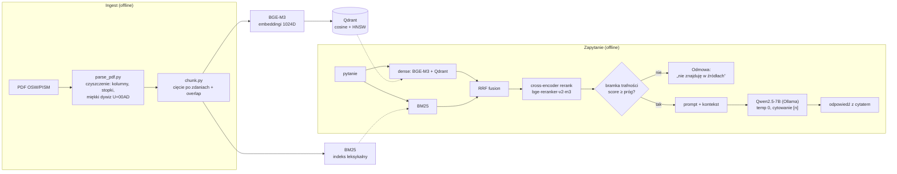

# offline-rag-pl — offline'owy RAG na polskich raportach analitycznych

System **Retrieval-Augmented Generation** działający **w pełni offline**: odpowiada na pytania
na podstawie polskich raportów analitycznych (OSW/PISM), **cytuje źródło** i ma **zmierzoną
jakość** (gold set + metryki + poprawa „przed/po"). Projekt portfolio pod stanowisko AI/LLMOps.

> „RAG na źródłach otwartych, ale architektura jest identyczna dla korpusu niejawnego — całość
> offline, model open-source serwowany lokalnie, dane nie opuszczają systemu. Jakość mam
> zmierzoną: gold set, recall@k, i poprawę po zmianie strategii."

---

## Architektura



Dwustopniowy retrieval (szybki bi-encoder → dokładny cross-encoder), hybryda gęste+leksykalne
(RRF), bramka anty-halucynacyjna i wymuszone cytowanie. Orkiestracja to cienka własna warstwa
(bez ciężkich frameworków).

---

## Wyniki (zmierzone na gold secie: 36 par, w tym 7 spoza korpusu)

### Retrieval — poprawa „przed/po" (29 pytań z korpusu)
| konfiguracja | recall@1 | recall@5 | MRR |
|---|--:|--:|--:|
| dense (baseline) | 0.45 | 0.76 | 0.62 |
| + reranking (cross-encoder) | 0.79 | 0.97 | 0.86 |
| **+ hybryda BM25 (RRF)** | **0.83** | **0.97** | **0.89** |

*Reranking podniósł recall@1 (trafny fragment był w puli, ale nie na górze); hybryda podniosła
sufit recall@10 z 0.93 do 0.97 (BM25 dorzucił trafienia leksykalne, których dense nie wyciągał).*

### Jakość odpowiedzi
| metryka | wynik |
|---|--:|
| refusal — pytania spoza korpusu (gold set, n=7) | 1.00 (0.71 → 0.86 prompt → 1.00 +bramka) |
| refusal — **hard negatives held-out (n=8), pełne 3 guardy** | **7/8** (guard #3 łapie atrybucję, której bramka nie) |
| false-refusal na pytaniach z korpusu — bramka (#2) | **0** |
| false-refusal dodane przez weryfikację (guard #3) | **2/29 (7%)** — świadomy koszt |
| faithfulness (sędzia: Gemma 2, niezależny od generatora) | 0.96 |
| answer relevance | 0.97 |

### Kalibracja progu bramki na HELD-OUCIE — i dlaczego 1.00 było optymistyczne

Próg bramki (`RELEVANCE_GATE_MIN`) był początkowo dobrany na **tym samym gold secie**, na którym
raportowałem `refusal` — to dopasowanie hiperparametru do zbioru testowego. Zbudowałem więc osobny,
**nigdy nieraportowany** zbiór `gold_set/heldout_gate.jsonl` (30 pytań), w którym pytania spoza
korpusu to w większości **hard negatives**: „na temat, ale bez odpowiedzi w naszych 5 raportach".

| top-score rerankera | zakres |
|---|--:|
| pytania z korpusu (n=12) | 0.7376 … 0.9998 |
| spoza korpusu: `daleki` (arytmetyka, wiedza ogólna, n=4) | 0.0000 … 0.0015 |
| spoza korpusu: `sąsiedni-obszar` (n=6) | 0.0014 … 0.1533 |
| spoza korpusu: **`bliski-temat` (hard negatives, n=8)** | 0.0220 … **0.9806** |

**Rozkłady się nakładają** (przerwa −0.243) → nie istnieje próg z zerem przecieków i zerem błędnych
odmów. Front kompromisu: próg 0.1 → przecieki 0.33 / FR 0 · 0.735 → 0.11 / 0 · 0.985 → 0 / **FR 0.33**.
End-to-end na 18 pytaniach OOC: refusal **0.89 z bramką i 0.89 bez bramki** — bramka nie dodaje na
nich nic, bo przecieki mają wysoki score. Oba przecieki to halucynacje **z cytowaniem**:
przypisanie Danii wskaźnika 1,75% PKB (w źródle: **Norwegii**) i zamiana listy ofert w przetargu
HX na jego rozstrzygnięcie.

**Wniosek architektoniczny:** cross-encoder mierzy **trafność tematyczną**, nie **obecność
odpowiedzi** (`relevance ≠ answerability`). To sufit tego sygnału, nie zła wartość progu — błąd
powstaje w warstwie **generacji**, więc kontrolę trzeba postawić właśnie tam.

```bash
python src/eval/calibrate_gate.py --e2e   # rozkłady, przemiatanie progu, odmowa end-to-end
```

### Guard #3 — weryfikacja ugruntowania po generacji (zmierzona)
Skoro błąd powstaje w warstwie generacji, kontrolę postawiłem właśnie tam: po wygenerowaniu
odpowiedzi **inny model-sędzia (Gemma)** sprawdza KAŻDĄ tezę przeciw kontekstowi; za mało popartych
→ odmowa (`src/generate/verify.py`).
- **Wartość:** na 8 hard negatives z held-outu pełne 3 guardy odmawiają **7/8**. Guard #3 sam łapie
  h18 („wydatki obronne Danii jako % PKB" — w źródle to liczba **Norwegii**), którego bramka
  przepuszcza (score 0.98).
- **Koszt (zmierzony, nie założony):** **+7% false-refusal** (2/29) na poprawnych pytaniach z korpusu —
  `VERIFY_MIN_SUPPORTED=1.0` wymaga poparcia WSZYSTKICH tez.
- **Residual:** h19 (lista ofert przetargu podana jako rozstrzygnięcie) wciąż przecieka — 1/8.
- **Trade-off (kontekst wywiadowczy):** fałszywa odmowa = ponowne zapytanie analityka; pewna
  halucynacja = błędna decyzja. Dlatego surowy próg (1.0) jest uzasadniony.

---

## Stack
- **Python 3.11**, orkiestracja = cienka własna warstwa (bez LangChain)
- **Ollama** + **Qwen2.5-7B** (kwantyzacja Q4, GPU) — LLM serwowany lokalnie
- **BGE-M3** (sentence-transformers) — embeddingi wielojęzyczne (1024D)
- **Qdrant** (Docker) — baza wektorowa (metryka cosine, indeks HNSW)
- **bge-reranker-v2-m3** — cross-encoder do rerankingu
- **BM25** (własna implementacja Okapi) + **RRF** — hybryda leksykalno-semantyczna
- **Gemma 2 9B** — niezależny model-sędzia do faithfulness (mniejsza cyrkularność)

---

## Uruchomienie
```bash
# 1. Środowisko
conda create -n offline-rag-pl python=3.11 && conda activate offline-rag-pl

# 2. Zależności (torch OSOBNO, z indeksu CUDA pod GPU — tu 12.8 dla Blackwella)
pip install torch --index-url https://download.pytorch.org/whl/cu128
pip install -r requirements.txt

# 3. Baza wektorowa (Qdrant w Dockerze, dane w named volume)
docker run -d --name qdrant-osw -p 6333:6333 -v qdrant_osw_storage:/qdrant/storage qdrant/qdrant

# 4. Modele LLM (raz — wymaga internetu; potem offline)
ollama pull qwen2.5:7b        # generator
ollama pull gemma2:9b         # sędzia do ewaluacji faithfulness

# 5. Pipeline: PDF -> tekst -> chunki -> indeks -> odpowiedź
python src/ingest/parse_pdf.py data/raw/<raport>.pdf data/processed/
python src/ingest/chunk.py
python src/index/build_index.py
python src/generate/answer.py "Które państwa tworzą arktyczny kwartet NATO?"

# 6. Ewaluacja
python src/eval/run_eval.py       # retrieval: recall@k, MRR (dense vs hybryda vs +rerank)
python src/eval/eval_answers.py   # odpowiedzi: refusal, faithfulness, relevance
```
> **Offline w runtime:** po pobraniu modeli ustaw `HF_HUB_OFFLINE=1` — całość działa bez sieci.

---

## Struktura repo
```
config/config.py        # WSZYSTKIE parametry (chunk size, top_k, modele, progi) w jednym miejscu
src/ingest/             # parse_pdf.py (czyszczenie PDF) + chunk.py (chunking)
src/index/build_index.py# embeddingi -> Qdrant
src/retrieve/           # search.py (dense), bm25.py, hybrid.py (RRF), rerank.py
src/generate/answer.py  # pętla RAG: retrieval -> bramka -> prompt -> LLM -> cytat
src/eval/               # metrics.py, run_eval.py (retrieval), eval_answers.py (odpowiedzi),
                        # calibrate_gate.py (kalibracja progu bramki na held-oucie)
gold_set/gold.jsonl     # zbiór ewaluacyjny (pytanie -> odpowiedź -> chunk źródłowy)
gold_set/heldout_gate.jsonl # held-out do kalibracji progu — NIGDY nieraportowany jako metryka
tests/                  # testy chunkingu, metryk, BM25/RRF
```

---

## Znane ograniczenia (świadome, zmierzone)
- **Kolejność kolumn** w niektórych dwukolumnowych PDF-ach bywa mieszana — wpływ na jakość mały
  po dodaniu hybrydy (zweryfikowane pomiarem).
- **Retrieval pojęciowy** (pytania „dlaczego/jak") słabszy niż faktograficzny (recall@5 ~0.89).
- **Cytowanie per-teza** na modelu 7B bywa nieprecyzyjne (grupuje źródła).
- **Metryki LLM-sędziego** to sygnał, nie prawda absolutna (cyrkularność mimo innego modelu) —
  zalecany ręczny sanity-check; wartości zależą od sędziego (faithfulness 0.88 Qwen vs 0.96 Gemma).
- **Gold set n=29** (z korpusu) — liczby wciąż nieco szumne. Próg bramki jest już kalibrowany na
  **osobnym held-oucie**, nie na gold secie (patrz sekcja o kalibracji).
- **Residual refusal:** przed bramką prosta arytmetyka przeciekała (model liczył); bramka to domyka.
- **Hard negatives** („na temat, ale odpowiedzi nie ma") — bramka ich nie łapie (`relevance ≠
  answerability`); dołożony guard #3 (weryfikacja ugruntowania po generacji) łapie **7/8** na
  held-oucie, ale kosztem **~7% false-refusal** na poprawnych odpowiedziach i z 1 przeciekiem
  (h19, oferta jako fakt). System nie jest tu idealny — każdą warstwę mierzę osobno.
